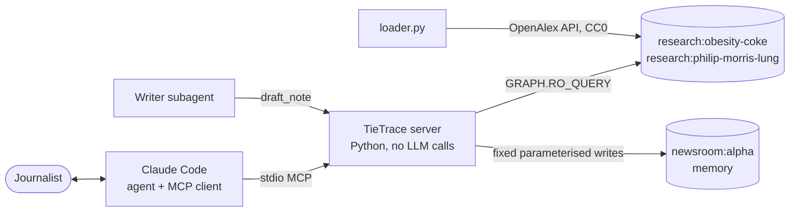

# Building TieTrace: a graph that shows who funds the experts journalists quote

*By Aaryan and Abdul, for FalkorDB Graph Hacks (Tracks 1 and 2). Updated Oct 17, 2026. Every number in this post was computed by our own scripts or test runs; where a number was only reported by a chat session, we say so.*

In 2015, journalists found that the Global Energy Balance Network (a group of scientists telling the public that exercise mattered more than diet in the obesity debate) had received money from Coca-Cola ([CNBC, republishing the New York Times](https://www.cnbc.com/2015/08/10/coca-cola-funds-scientists-who-shift-blame-for-obesity-away-from-bad-diets.html)). Many of those scientists had been quoted as neutral experts for years.

A reporter on deadline cannot read the funding section of every paper an expert has written. So we built **TieTrace**: you name a company, a topic and the experts you plan to quote, and it tells you what ties the research record shows, with the DOI of every paper behind each one.

What it will never do is call someone "independent". It says *"ties found in the research record"*, or *"no tie found"* together with the exact limits of that search, because a missing record is not proof of anything.

## What the journalist gets

1. **A tier for each expert, with evidence.** Tier A means direct evidence: a paper funded by the company or its foundation, or a company affiliation listed on a paper. Each item comes with its DOI, year, funder, and whether it is on-topic.
2. **"No tie found", with its scope.** Up to 3 co-author hops, papers from 2021 to 2026, and how many papers in the graph list a funder at all, for the whole graph and for that expert.
3. **A verified sourcing note.** A Writer agent picks the claims and a Verifier checks every one. Then a human approves the note and it is exported as markdown with DOI links.
4. **Memory.** Next week a colleague opens a new story with the same expert, and TieTrace says *"already checked on Oct 16, tier A2 via Coca-Cola Foundation funding"*.

## How it works

- **Claude Code is the agent.** It reads the request and chooses among 13 MCP tools. The server itself makes no LLM calls and needs no API key. Everything it does is plain Python and Cypher.
- **FalkorDB holds several graphs.** It keeps one read-only research graph per case (`research:<case>`), plus one memory graph per newsroom (`newsroom:<id>`). The newsroom is set by an environment variable and is never a tool argument, so one newsroom cannot read another's memory.
- **Every answer carries its own proof.** The response includes the exact Cypher it ran, the graph name and data version, any verdicts that were applied, and any warnings.

### FalkorDB features doing the work

| Feature | What we use it for |
|---|---|
| `algo.BFS` | The "no tie found" check: the shortest co-author path from an expert to anyone with direct ties, up to 3 hops |
| `algo.maxFlow` | Tested in E4 as an alternative tie strength; not used for findings (no depth limit) |
| Variable-length paths `[:PARENT_OF*0..3]` | Corporate families: an affiliation with a subsidiary or bottler still counts as Coca-Cola |
| `GRAPH.RO_QUERY` | Every query the model can trigger is read-only, enforced by the database |
| Multiple graphs | Research graphs and per-newsroom memory graphs live side by side, isolated |
| `RENAME` | Rebuilds go into `staging:<case>` and are swapped in only after a self-check |
| AOF persistence | A crash loses at most about a second of memory writes |

## The data

We built the main graph from [OpenAlex](https://openalex.org) (CC0). It loads three sets of works:
- every work funded by the Coca-Cola company or the Coca-Cola Foundation, on any topic;
- every work with a Coca-Cola-family affiliation;
- a per-year sample of the most-cited obesity and physical-activity papers from 2010 to 2026.

| | Coca-Cola × obesity | Philip Morris × lung cancer |
|---|---|---|
| Works | 31,291 | 21,756 |
| People | 85,511 | 68,723 |
| Co-author edges (stored both ways) | 1,326,194 | 1,458,502 |
| People with direct ties (Tier A) | 3,035 | 3,649 |
| Graph memory (FalkorDB 4.22.1) | 780 MB | 726 MB |
| Download | about 1,600 API calls | 915 API calls, 13 min |
| Rebuild from cache | 60 s, 0 API calls | built once |

The second case shows TieTrace isn't hard-wired to Coca-Cola. A `discover.py` script lists candidate funder and institution IDs. A human then approves which entities count as "the company": we kept Philip Morris International and the Foundation for a Smoke-Free World, and rejected Altria, Vectura and Swedish Match, each with a recorded reason. A dry run shows the cost, and only then does the build start.

## Benchmarks: what passed, and what failed

We fixed the pass rules **before** running anything, and we did not change them after seeing the results. Two of the four core tests failed, and we are reporting both.

| Test | What it asks | Result |
|---|---|---|
| **E7 coverage** | How much of the data can show funding at all? | 56.3% of the 30,140 loaded topic works list a funder; 96.6% list a funder or an affiliation. The topic part is about 11.5% of the field. |
| **E3 known case** | Does it find the publicly reported GEBN scientists? | **4 of 4** publicly confirmed leaders come out Tier A with DOIs. Blair and Hand are A1 (company money). Hill and Peters are A2 (Coca-Cola Foundation). We could not confirm a fifth name, so we did not guess one. |
| **E1 placebo lift** | Is repeated co-authorship with tied people (Tier B) more common than chance? | **FAIL.** The lift is 0.96x (interval 0.84–1.09) against 100 random groups matched on publication count. |
| **E2 temporal hold-out** | Does our network score predict who gets tied later? | **FAIL.** The weighted score scored AUC 0.716, no better than publication volume (0.720) or a plain count of tied co-authors (0.749). |
| **E11 memory** | Does a new session remember an earlier case? | **Pass**, in real Claude Code. |
| **Second case** | Does the whole flow work on Philip Morris? | **Pass**, end to end. Only 37.5% of that graph's topic works list a funder (7,482 of 19,964), and the answer said so. |
| **E8 golden tests** | Do 15 fixed checks always give the same answer? | **15 of 15 pass** (including the four public GEBN results: Hill A2, Blair A1, Hand A1, Peters A2). |
| **E9 concurrency** | Two reporter sessions writing at once: is anything lost? | **Pass.** `check_case` and `record_verdict` ran in two server processes with proven overlap; nothing was lost, and every saved check equals a fresh rerun. |
| **E10 tenant isolation** | Can newsroom alpha see newsroom beta? | **Pass.** All 13 tools were tried with the other newsroom's ids: 0 rows or NOT_FOUND every time. |
| **E6 mega-paper ablation** | How much depends on our 25-author cap? | Tier A stays 3,035 people either way. Without the cap, A1 grows from 949 to 1,069 and Tier B from 1,309 to 1,889, so **23.7%** of A1 and B people would rest only on papers with more than 25 authors. The cap stays. |
| **E4 max flow** | Does `algo.maxFlow` rank people differently from a simple path sum? | Spearman 0.86 (0.73 within 3 links); top-10 overlap 6 of 10. But max flow has no depth limit and refused our decimal weights, so we use it for **no finding**. |
| **E5 profile hand-check** | How often are OpenAlex profiles wrong? | **Cut.** We drew a 50-profile sample, but only a person can judge it, so we claim no error rate. |

**What we changed after E1 and E2 failed.** Tier B, Tier C and the score are still shown, but every answer labels them *"network context only, not validated"*. Results are no longer sorted by score: they list Tier A1, then A2, then everyone else in the order given. The finding we stand behind is Tier A, where every claim has a DOI.

**One more thing we changed after an outside review:** "no tie found" used to quote 96.6% coverage. That figure counts affiliations, which say little about funding. It now quotes the funder-only figure, both for the whole graph and for that expert, for example "56% of topic works list a funder (this expert: 92% of 26 works)", from the gate run.

### Speed

| Operation | Time |
|---|---|
| `tie_report`, first call / cached | 0.37 s / under 0.01 s |
| `find_experts` | 0.37 s |
| `bridges` at 3 hops (the slowest query) | 1.5 s first call, 1.2 s cached |
| No-tie check, median over 8 experts | 15.3 ms → **9.3 ms** after we stopped running the same BFS twice |
| Memory log write per tool call | about 0.3 ms |
| Concurrent writes: 4 processes × 50 calls | 200 of 200 events saved |
| E4: path sum vs max flow, per person | 0.026 s vs 0.051 s |

## The full flow, run live

This was run in Claude Code on Oct 16:

1. **Open the case.** We opened "Soda tax schools" with Steven Blair and James O. Hill. TieTrace recalled that both had been checked that morning in another case.
2. **Check them.** `check_case` found Blair A1 and Hill A2, with DOIs.
3. **Exclude a paper.** We excluded paper `10.1016/j.mhpa.2017.12.001` as out of scope. Claude Code stopped and asked for permission, because `record_verdict` is human-only. The verdict re-ran every saved check in the newsroom: Blair dropped from 6 direct works to 5 and stayed A1. The check from the older case was replaced as well.
4. **Draft the note.** The Writer subagent drafted the sourcing note, and the Verifier passed it on the first try.
5. **Approve it.** Claude Code asked for permission again, for `approve_note`. TieTrace then exported markdown in which every DOI says what it shows, for example *"(FUNDED_BY Coca-Cola Foundation, tier A2, on-topic, 2016)"*.

The note uses "Expert #1" and "Expert #2", even though these two scientists are a public case. Names appear only when a case is explicitly marked public.

## How we built it: two agents, one brutal

We are two beginners, and the hackathon rules say we have to be able to explain every line. So every piece went through a loop:

1. A **Builder** agent writes the code.
2. A separate **Reviewer** agent tries hard to break it. It checks the code against the spec, writes its own tests, and deliberately breaks the code (mutation testing) to prove those tests catch real bugs.
3. Anything it must fail goes back to the Builder.

The Reviewer caught real problems almost every time:

| Piece | Rounds | Examples of what it caught |
|---|---|---|
| Discovery CLI | FAIL → PASS | One person split into two profiles in OpenAlex was hidden behind a "unique" match |
| Memory graph | FAIL → PASS | A public case leaked the names of 11 co-authors who were not public |
| Obsidian export | FAIL → FAIL → PASS | A silent 5,000-row cut; it could overwrite the user's own notes |
| Verdicts and notes | FAIL → FAIL → FAIL → PASS | A "no tie found" claim could still say "but Coca-Cola gave Expert #2 a grant"; one DOI cited three ways counted as three papers |

The fix for that last one ended up shaping the design. **The server now writes every sentence in a sourcing note itself.** The Writer only chooses which claims and DOIs to include, so nothing it types can reach a published note.

On Oct 16 the project had **9 test suites, all passing** on Linux (checkpoint 8 added golden, concurrency and isolation suites, and each passes 15/15, 1/1 and 1/1):

| Suite | Tests |
|---|---|
| loader | 49 |
| research | 54 |
| server | 26 |
| eval | 13 |
| cases | 27 |
| discover | 26 |
| memory | 32 |
| obsidian | 22 |
| notes | 40 |

## FalkorDB lessons, the hard way

- **Undirected matches count inconsistently.** `()-[r]-()` counted 3 edges where `(a:P)-[r]-(b:P)` counted 6. We now store co-authorship in both directions and always match with `->`.
- **`algo.BFS` has two quirks.** It follows outgoing edges only, and when nothing is reached it returns *no row* rather than an empty list.
- **Results are capped at 10,000 rows without warning.** Count inside Cypher, never by counting returned rows.
- **An `UNWIND`, then a traversal, skips the index.** `WHERE x.id IN $ids` keeps it.
- **On Oct 8, `:latest` pointed to 6.0.2,** the new Rust version. `toLower()` on a paper title containing a garbled character crashed the server. We pinned `v4.22.1`, on which the same graph also uses half the memory (780 MB instead of 1,554 MB).
- **A Docker shutdown once interrupted the final snapshot,** and FalkorDB reloaded an older one. We turned on AOF and proved it with a hard-kill test.
- **On 4.22.1, `OPTIONAL MATCH ... WITH d WHERE d IS NULL` does not filter.** For "write only if absent", use `WITH count(d) AS n WHERE n = 0`.
- **`algo.maxFlow` refused our decimal weights** ("capacity range too wide") even though they only span 0.087 to 6.3, and it has no depth limit. It found routes longer than 3 links for 29 of 200 people.

## Honest limits

- **Funder data is thin.** Only about half of the papers in each graph record a funder, so "no tie found" often just means "no funding recorded". Every answer says so.
- **The graph is a sample.** It holds the most-cited papers per year, and co-authors' other papers are not loaded.
- **Gifts to universities are invisible.** That was the money in the 2015 GEBN story, and OpenAlex funder fields do not record it.
- **One person can be split across several OpenAlex profiles.** A human can merge them with a verdict.
- **Profile accuracy is unmeasured.** The E5 hand-check was cut, so we claim no error rate for OpenAlex's author matching.
- **Tier B and C are context, not findings.** E1 and E2 failed, and E6 shows a quarter of the network ties would depend on very large papers without our cap.

## Credits

- **Data:** [OpenAlex](https://openalex.org) (CC0).
- **Database:** [FalkorDB](https://www.falkordb.com).
- **Agent:** built with Claude Code as the agent and MCP client. Every AI-written part is logged in `AI_USE.md`, along with how we checked it.
- **Code:** [github.com/Aaryan-Degama/TieTrace](https://github.com/Aaryan-Degama/TieTrace).
