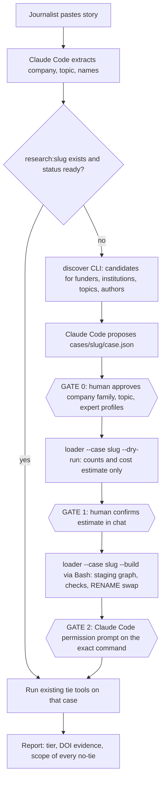

# Generalising TieTrace to any company, topic and experts

*Last updated by Abdul, Oct 16 2026: first version (research by Claude Code).*

**Labels used below:** [V] = verified in the research notes (live probe, repo or docs read on Oct 15 2026); [D] = stated in vendor docs; [I] = inference by the researcher or by this plan, not tested. Anything marked [I] is a proposal to be checked, not a fact. Nothing in this plan is implemented yet.

## BLUF

TieTrace can handle "Philip Morris + lung cancer screening + three named experts" with **one new human-approved CLI step in front of the existing, unchanged tie tools**: Claude Code proposes a per-case config file, a deterministic script discovers and checks OpenAlex IDs, a human approves the exact build command, and the loader builds a per-case graph (`research:<slug>`) that the read-only MCP tools then query. The server stays read-only, makes no LLM calls and never sees the OpenAlex key. The expensive-sounding part is cheap: a new case costs about **$0.17 and 1,300 list calls** (estimate [I], ~5 cases per free-key day) and a few minutes of download. The binding constraints are different: **RAM** (today's graph is ~780 MB by `GRAPH.MEMORY`, Docker Desktop has ~7.75 GiB, so about 6-8 graphs, not 10), **judgement steps** (which funder IDs are "the company", which of 16,059 "Maria Garcia" profiles is the expert) and a **verified persistence bug** (the graph was lost once after a Docker restart). For the Oct 18 6 PM IST deadline, ship a minimum viable version (checkpoints 5b-5f below: persistence fix, `case.json` for Coca-Cola, `--case` loader with staging swap, case-aware research/server with `NO_GRAPH`, discovery CLI, one hand-approved Philip Morris case). Leave the automated corporate-family pipeline, ACLs and background-build tools as future work. In the project's cut order this whole effort is the "second topic" item, so it is the first thing to cut if the team falls behind.

## 1. Problem: what happens today with the Philip Morris prompt

The example prompt asks Claude Code to resolve three names, check whatever matches, and report tier, DOI evidence and the exact scope of any "no tie found". Today the graph is `research:obesity-coke` and the company, topic and public-case list are hard-coded (`GRAPH` in research.py:19, 20 `GRAPH` references; loader.py constants `COMPANY_FUNDER`, `TOPICS`, `COKE_FAMILY`; `GEBN_PUBLIC_IDS` in server.py:44) [V]. Observed behaviour as reported by the authors for this prompt: names come back **AMBIGUOUS**, the tools warn that the company/topic is the wrong one (Coca-Cola/obesity), and there is **no data** for Philip Morris or lung cancer. The query logic itself is already mostly generic, because tier thresholds and years are read from the graph's `Meta` node (research.py:134-138, 166) [V]; the work is plumbing (which graph, which config) plus a safe way to create the data.

Two traps make "just search OpenAlex by name" unsafe [V, live probes]:

| Problem | Evidence from the notes |
|---|---|
| Company name finds the wrong or an incomplete set | `/funders?search=philip morris` returns PMI `F4320315260` **and** Foundation for a Smoke-Free World `F4320318650` (a different legal entity). Altria `F4320308222` is not returned at all. `/funders?search=reynolds american` returns 0 rows. Funders are flat: no parent/child field ([Funders doc](https://help.openalex.org/data/funders/)). |
| Institution hierarchy is partial | PMI US `I4210088192` has Swiss and German children, Altria `I4210158204` has none; Coca-Cola `I1312732213` has none. Lineage comes from ROR ([Institution object](https://help.openalex.org/api-entities/institutions/institution-object)). |
| Topic IDs are coarse | `/topics?search=lung cancer screening` returns one topic `T10202` (205,297 works) that also covers surgery; the phrase `title_and_abstract.search:"lung cancer screening"` matches 12,703 works. `/autocomplete/topics` returned 0 for the same query. |
| Names are ambiguous | `/authors?search=maria garcia` count 16,059; Rajesh Kumar ~3,100-3,400. A wrong Rajesh Kumar (Delhi, 979 works) has the top topic "Nanofluid Flow and Heat Transfer". Disambiguation is ML with documented split and merge errors ([Disambiguation](https://help.openalex.org/data/authors/disambiguation/)). |
| "No funder record" is not "no funding" | Only 18.2% of 2023 works carry any funder (10.9% in 2015) [V live counts]; one PMI-funded work has `awards = []`. |

## 2. Target workflow, with human gates



1. The journalist gives the story. Claude Code (the orchestrator) extracts company, topic and expert names. Judgement, no tool.
2. Claude Code calls a new read-only `list_cases` tool (reads `GRAPH.LIST` and each graph's `Meta`) [I]. If `research:<slug>` is `ready`, skip to step 9.
3. Claude Code runs the **discover CLI** (deterministic, Bash). It prints candidate lists: funders, institutions, topics/keywords, author cards. It reads `.env`; the model never sees the key.
4. Claude Code writes `cases/<slug>/case.json` with the candidates it judges right and the rejected ones with a reason.
5. **GATE 0 (human):** the authors and, for real use, the journalist approve the corporate family (e.g. PMI vs Altria vs Foundation for a Smoke-Free World), the topic IDs, and which author profile is each expert.
6. `uv run python loader.py --case <slug> --dry-run` writes nothing and prints expected calls, works, dollars, minutes and projected RAM.
7. **GATE 1 (human):** confirm the estimate in chat.
8. **GATE 2 (human):** `uv run python loader.py --case <slug> --build` runs through Bash. Claude Code's permission prompt shows the exact command; the `--build` form is never allowlisted. The loader builds `staging:<slug>`, self-checks, then swaps it over `research:<slug>`.
9. Existing tools (`resolve_name`, ties, evidence, bridges) run against the case graph. Every envelope names the graph and `data_version` in its scope.
10. The final report gives, per expert, the tier, DOIs, and for each "no tie": query name, hops, years and coverage (including the funder-coverage denominator).

## 3. Design decisions and recommendations

| # | Decision | Recommendation | Why (source) |
|---|---|---|---|
| D1 | Case config file | `cases/<slug>/case.json`, one file per case, validated with plain dict checks. `cases/obesity-coke/case.json` reproduces today's constants exactly. Fields: company funders/institutions with `kind`/`rel`, topic IDs/years/cap, `public_ids`, thresholds (`small_paper`, `recent_year`, `works_count_anomaly`), `max_api_calls`, and `decided_by` + date per decision. Reject unknown keys, file < 20 KB, ID lists <= 20. | Makes reruns deterministic and auditable; the model only proposes a file, a validator decides what is legal [I]. Schema sketch and constants list [V] from loader.py:25-68. |
| D2 | Discovery step | A CLI (`discover`), not model-callable MCP tools. It uses `/funders?search`, `/institutions?search`, `/topics?search` plus `/keywords?search` (not topic autocomplete), `/autocomplete/authors` (free) and per-candidate counts. Return `candidates` with id, name, type, country, ROR, works_count, description, parent/children, plus for authors: ORCID, last institution, topic overlap with the chosen topics, funder-coverage share, `status unique / ambiguous / not_found`. Never auto-pick. | The server must not hold the key (the notes' find_* MCP tools would need it; the CLI pattern avoids that) [I]. Search is cheap; autocomplete cost 0.0 [V]. Merge risk inflates ties, split risk hides them, so show alternatives and sibling profiles [I]. |
| D3 | Corporate-family candidates | MVP: Claude Code seeds the family by hand from discovery output, a human approves, and the choice is stored in `case.json`. Later: a deterministic pipeline writes `candidates.json` rows (`status: proposed`) from ROR relationships, Wikidata P355/P749/P127 (class-filtered), GLEIF children and SEC Exhibit 21; human sets `approved/rejected` and `rel`; the loader reads only `approved`. Resolve the seed by ROR or Wikidata ID, not by name. | No single source is complete: lineage exists for PMI (2 children) but not Coca-Cola or Altria [V]; Wikidata gave 133 raw Coca-Cola rows, mostly brands, patents and places [V]; Exhibit 21 gives ~240 PMI entities but no IDs and no independent bottlers [V]; GLEIF has a same-name collision (an Australian "Coca-Cola Company") [V]. The one-hour review estimate is a guess [I]. |
| D4 | Foundations and fronts | Keep foundation/funding-vehicle IDs separate, with their own `rel`; never collapse into the company by ROR. Describe them only as "described in <source URL> as ...". Trade groups with no formal link are `needs_human_source` with a manual-add field. | The two Coca-Cola funders share one ROR and one Wikidata ID but are different funders (796 vs 91 works) [V]; FSFW's "front organization" text is Wikidata/OpenAlex editorial, not TieTrace's claim [V]. The banned-word rule applies to labels too. |
| D5 | Build path | **Human-approved CLI via Bash; the MCP server stays read-only.** Not `start_build/build_status`, not MCP Tasks, not elicitation. | Smallest and safest (~30-60 lines on the loader). A model-reachable write breaks "no write path from the model" and needs `readOnlyHint=False` plus an allowlist exception. SDK `mcp` 2.3.0 has no Tasks server implementation; Claude Code auto-backgrounds calls over 2 minutes and there is no evidence it uses the Tasks extension; elicitation can be auto-answered by hooks ([Claude Code MCP docs](https://code.claude.com/docs/en/mcp), notes section 1-3) [V]. |
| D6 | Staging graph and atomic swap | Build `staging:<slug>`, self-check (node counts > 0, `Meta` with `data_version`, `recent_year`, `build_status=complete`), then Redis `RENAME staging:<slug> research:<slug>`. Keep `GRAPH.COPY` as an optional backup. Pin a test for RENAME. | Today `--rebuild` deletes first (loader.py:466-469), so a failed rebuild leaves nothing [V]. RENAME replaced an existing graph key atomically in module 4.22.1 and kept indexes, but **FalkorDB does not document it** and the test used a 1,000-node graph [V]. `GRAPH.COPY` fails safely onto an existing key (0.19 s for 1,000 nodes) [V]. |
| D7 | Naming and registry | Graph `research:<slug>`, `SLUG_RE ^[a-z0-9][a-z0-9-]{1,39}$`; existing graph is slug `obesity-coke`. Registry = `cases/<slug>/case.json` plus loader-written `status.json` (`building / ready / failed / archived`, `built_at`, `data_version`, `config_hash`, `counts`, `total_graph_sz_mb`). Move cache to `cases/<slug>/raw/`. | Status must live outside the graph being built; `Meta` already holds `built_at`, `data_version`, `counts`, `load_scope` (loader.py:509-527) [V]. A separate registry graph would add a write path for ~10 cases [I]. |
| D8 | `NO_GRAPH` error code | Add `NO_GRAPH` to spec section 4 and to the envelope; map FalkorDB's `Invalid graph operation on empty key` (today `DB_ERROR`, research.py:77) to it. Message lists known cases. | RO_QUERY never creates a key; `GRAPH.QUERY` on a typo would create a junk graph, so reads stay RO and writes stay in the loader [V]. Spec and code must change together (project rule). |
| D9 | Case selection | A `case` slug argument on tools, validated against the registry, default from env `TIETRACE_CASE` (fallback `obesity-coke`). The newsroom still comes only from `TIETRACE_NEWSROOM`. **Open for the team to decide**: the rules say the newsroom (not the case) comes from env. | Tools never take a graph name, only a slug that is looked up in a dict built from disk [I]. |
| D10 | Per-graph caches | Contextvar for the current graph (default `research:obesity-coke`), `_cached` key becomes `(graph, key)`, `clear_cache(graph=None)`, per-case `RAW` folder, per-case public-ID list from config. Keep `research.GRAPH` and `loader.GRAPH` as module attributes. | `_cache` keys `meta`, `tier_a`, `staff` are name-only today, so a second graph would silently return the first graph's Tier-A map: a correctness and ethics bug [V]. Existing tests import `research.GRAPH` (test_research.py:55) and `loader.GRAPH`, and test_server.py:135 asserts logged graph equals `research.GRAPH` [V]. |
| D11 | Tenancy | Research graphs are shared and read-only (public OpenAlex data only); tenant data stays in `newsroom:<id>`, keyed by (case slug, expert id). Second guard in `ro_query`: graph must match `^research:[a-z0-9-]{2,40}$`. Optional Redis ACL user limited to `research:*` with `+graph.ro_query +graph.list` (untested; cut if short on time). | Per-newsroom copies would multiply RAM for no isolation gain. Graph names are literal keys, so the risk is naming another existing key, not command injection [V]. |
| D12 | API key | Only the CLI reads `.env`. Never pass `OPENALEX_API_KEY` to the MCP server config; add a deny rule for reading `.env` (syntax not re-checked). | Server never needs the key under D2/D5 [I]. |

## 4. Who does what: code, Claude Code, human

| Step | Deterministic code (no LLM) | Claude Code judgement | Human |
|---|---|---|---|
| Extract company, topic, names from story | none | does it | journalist confirms wording |
| Candidate lists (funders, institutions, topics, authors, with counts) | discover CLI | reads and compares | none |
| Pick company family, roles (parent, subsidiary, foundation, bottler) | candidate generation and ID crosswalk (later) | proposes, with sources | **approves** (Altria vs PMI is an editorial scoping call to log in `scope`) |
| Pick topic IDs / phrase and caps | counts per `topics.id`, `primary_topic.id`, phrase | proposes | approves |
| Pick the expert's author profile | author cards with `unique / ambiguous / not_found` | proposes; asks the journalist if ambiguous | **approves** |
| Validate config, dry-run estimate | validator, `--dry-run` | presents it | confirms (Gate 1) |
| Download, build, swap, self-check | loader (fixed, parameterised writes) | runs the command | **permission prompt (Gate 2)** |
| Tier, evidence, bridges, verifier | existing tools (RO_QUERY, envelope) | calls them | none |
| Wording of the final report | verifier rejects claims without DOI / without scope; banned-word check | writes "ties found in the research record" | reads it |

Note: the Verifier already requires a stored edge with a DOI for a positive claim, and a `query_name` plus scope for a "no tie" claim; that is unchanged. A no-tie scope should also carry the **funder-coverage denominator** per expert (works with and without `funders.id:!null`, ~2 count calls, ~$0.0002 each expert) [I].

## 5. Costs, limits and the persistence problem

**API cost (estimate [I], derived from [OpenAlex example costs](https://help.openalex.org/access/example-costs/) and [pricing](https://help.openalex.org/access/pricing/)).** Singleton lookups are free, list/filter calls cost $0.10 per 1,000, search $1 per 1,000. A free key gives $1/day; without a key the shared budget is $0.10/day per network IP. Rate limits: 10 req/s no key, 30 req/s free key ([Authentication guide](https://help.openalex.org/guides/authentication)). Empty searches and autocomplete showed `cost_usd` 0.0 [V].

| Item | Calls | Cost |
|---|---|---|
| Discovery searches | ~40 searches | ~$0.04 |
| Funded works (~1,000) | 10 list | ~$0.001 |
| Topic works (30,000 cap) | 300 list | ~$0.03 |
| Author `works_count` lookups (~95,000, Coca-Cola scale) | ~950 list | ~$0.095 |
| Per expert extras | 3-5 each | ~$0.002 |
| **Total per case** | **~1,300 list + ~40 search** | **~$0.17**, so ~5 cases per free-key day |

Time: ~2-4 minutes for 1,300 calls at 5 threads, 1-2 minutes of that is sequential cursor paging [I, not measured; no recorded timing from the Coca-Cola run]. The binding limits are the 10,000-result basic paging cap (cursor needs a key) and sampling: the graph's coverage statement must record the cap and sampling rule, as loader.py does [I]. The PMI-scale numbers are small: funded works 977 (funder record says 990), institution-lineage works 985, overlap 247, raw-affiliation search 1,834 (low-confidence recall booster, not an automatic edge) [V].

**Memory and disk (the real ceiling).** `GRAPH.MEMORY USAGE research:obesity-coke` = **780 MB** (real server `used_memory` ~591 MB, so budget 600-780 MB); COAUTH is 584 MB, ~75% of the graph (1.33M edges, stored both directions, with list properties). Docker Desktop reports **~7.75 GiB** (`MemTotal` 8,328,429,568 bytes), `maxmemory` is 0 with `noeviction`, so FalkorDB grows until the WSL2 VM is killed [V]. Ten graphs of today's size (6-8 GB) do not fit with headroom; a rebuild by RENAME swap transiently needs up to 2x for that case [I]. Disk is easy: RDB 63 MB, raw cache 294 MB per case [V]. Levers in order: load only the case in use and `GRAPH.DELETE` idle ones (rebuild from `cases/<slug>/raw/` costs zero API calls per CLAUDE.md); lower `topic.cap`; slim COAUTH list properties (a data-model change, so a team decision, not a drive-by) [I]. Record `total_graph_sz_mb` in `status.json` after each build and add a pre-flight check of `INFO memory` against `docker info` before building (`maxmemory` is not a safe guard) [I]. The vendor claims 10,000+ graphs per deployment (untested, [multigraph post](https://www.falkordb.com/news-updates/multigraph-topology-isolation-linear-scale/)), but that is irrelevant at our graph size.

**Persistence problem (pre-requisite risk).** Docker logs show SIGTERM at 17:42:52 with "Saving the final RDB snapshot", then at 17:42:54 a load of an RDB 10,068 seconds old; the data directory held `dump.rdb` dated 14:55 and a partial `temp-1.rdb` (31 MB) [V]. So the final save did not finish and the old snapshot was loaded. Likely mechanism: Docker/WSL2 shutdown or the default 10 s `docker stop` grace killed Redis mid-save of a ~600 MB dataset [I]. Current settings: `save "3600 1 300 100 60 10000"`, `appendonly no`, restart policy `no`, volume mounted at the documented path `/var/lib/falkordb/data`, so this is not the wrong-mount failure reported elsewhere [V]. Recommended (proposal [I], **`REDIS_ARGS` not verified to be honoured by this image**; check with `docker exec falkordb redis-cli CONFIG GET appendonly`):

```
docker run -d --name falkordb -p 6380:6379 -p 3001:3000 -v falkordb-data:/var/lib/falkordb/data \
  -e REDIS_ARGS="--appendonly yes --appendfsync everysec --save '300 1 60 1000'" \
  --stop-timeout 120 falkordb/falkordb:latest
```

Docs recommend RDB plus AOF with `appendfsync everysec` ([Data durability](https://docs.falkordb.com/operations/durability/)). Before closing Docker Desktop run `redis-cli SAVE` (or `BGSAVE` and wait for `rdb_bgsave_in_progress:0`), then `docker stop falkordb`. Because the graph is rebuildable from `data/raw/` with no API calls, a loss costs minutes, not data; but do this fix **first**, before any demo, and keep a `GRAPH.COPY` backup of the Coca-Cola graph until after Oct 18.

## 6. Phased implementation plan

New checkpoints are numbered after the existing ones (5 is the MCP server; 6-9 stay as in `checkpoints.md`). Sizes are estimates [I] (the notes put the whole refactor at ~300-450 lines, medium risk). **Rule for every step: the Coca-Cola graph stays the default case and the five existing test files pass unchanged** (`tests/test_loader.py`, `test_research.py`, `test_server.py`, `test_eval.py`, plus `eval/` scripts that call `research._tier_a([])` etc.).

| # | Checkpoint | Deliverables | Files touched | Size | Tests that must stay green / new tests | Tier | Owner |
|---|---|---|---|---|---|---|---|
| 5b | Persistence fix | AOF + `--stop-timeout`, SAVE-before-shutdown note, verify with CONFIG GET, restart test | `CLAUDE.md` commands, `AI_USE.md`, docker command | ~0 code | New: write, SAVE, `docker restart`, read back | **MVP (do first)** | Abdul or Aryan (TBD) |
| 5c | Case config + loader `--case` | `cases/obesity-coke/case.json` equal to today's constants; `load_config(slug)` + validator; `--case` (default `obesity-coke`); per-case `RAW`; Meta gets `slug`, `config_hash`; `status.json`; staging graph + RENAME swap; `--dry-run` (counts only, `per_page=1` + `meta.count`) | `loader.py`, new `cases/`, spec section 3 | ~150-200 lines | All of `test_loader.py` unchanged (keeps `loader.GRAPH`, `SMALL_PAPER`, `COKE_FAMILY`); new: `load_config("obesity-coke")` equals old constants, invalid configs rejected, RENAME swap on a scratch graph, failed build leaves old graph untouched | **MVP** | Abdul or Aryan (TBD) |
| 5d | Case-aware research and server | contextvar graph, keyed caches, `ro_query` name guard, `case` argument, registry from `cases/*/status.json`, `list_cases` tool, `NO_GRAPH`, per-case `public_ids`, graph + `data_version` in scope | `research.py`, `server.py`, `docs/mcp-spec.md` (sections 3, 4, 9) | ~100-150 lines | `test_research.py`, `test_server.py` unchanged; new (E10 style): bad slugs (`newsroom:alpha`, `../x`, `RESEARCH:X`) give `NO_GRAPH`/`INVALID_ARG` and `GRAPH.LIST` is unchanged; two tiny graphs prove caches do not leak; `cypher[].graph` equals the resolved graph | **MVP** | Abdul or Aryan (TBD) |
| 5e | Discovery CLI | `discover` for funders, institutions, topics/keywords, authors (candidate cards, `unique/ambiguous/not_found`, funder-coverage share); candidates JSON written to `cases/<slug>/`; case-builder slash command/skill and agent in `.claude/` (check format at the Claude Code skills and sub-agents docs first) | new `discover.py`, `.claude/commands` or skill, `.claude/agents/` | ~150-250 lines | New unit tests with recorded OpenAlex JSON fixtures (fixtures are the only allowed synthetic data); live smoke test off by default | **MVP** (author cards and funder search are the demo core) | Abdul or Aryan (TBD) |
| 5f | Philip Morris demo case | Hand-approved `cases/philip-morris-lung/case.json` (PMI funder + institutions; Altria and FSFW as explicit, labelled decisions), real build, run the example prompt, record results honestly in `eval/results.md` | `cases/`, `eval/results.md`, `AI_USE.md` | data + docs | Full existing suite green; the three-expert prompt runs end to end; a no-tie result shows hops, years, coverage | **MVP (the proof)** | Abdul or Aryan (TBD) |
| 5g | Optional hardening | PreToolUse hook that denies `loader.py` calls with `--refresh` or without a valid `--case`; `.env` read deny rule; pre-flight RAM check; record `total_graph_sz_mb` | `.claude/settings.json`, `loader.py` | ~50 lines | Hook unit test | Later if time | Abdul or Aryan (TBD) |
| 5h | Family candidate pipeline | ROR + Wikidata (class-filtered) + GLEIF + Exhibit 21 into `candidates.json` with `proposed/approved/rejected`, name normalisation (casefold, strip accents and legal suffixes, "(Country)"), match type shown | new `family.py` | ~200+ lines | Fixture tests; no live calls in the suite | Later | Abdul or Aryan (TBD) |
| 5i | Future work (document only) | `start_build/build_status`, MCP Tasks, elicitation gate, read-only Redis ACL user, COAUTH slimming, `--case` for E1-E8 | none | n/a | n/a | Future work | n/a |

**Minimum viable version (target: done by end of Oct 17 so Oct 18 is README, video and submission):** 5b, 5c, 5d, 5e (authors and funder/institution/topic search only) and 5f. The family for Philip Morris is chosen by hand from discovery output and approved by a human, which is allowed by the project rule ("hand-checked corporate family with human approval") and removes the largest unmeasured effort. **Realism check:** checkpoints 6-9 (memory graph, verdicts/notes/Writer, remaining evaluation, README/video/submit) are still `unassigned` in `checkpoints.md`, and 5c-5e alone are roughly 400-600 lines for two beginners; the notes give no schedule data, so this is a risk, not a promise.

**Cut order (extends the project's list).** The project's order is: second topic, deployment, blog post, Review Desk, `set_policy`, max-flow test (E4). This plan is the "second topic" item, so **if behind, cut in this order: 5h, 5g, then the 5e polish (slash command/agent), then 5f's live build (replace with a recorded dry-run plus the case config), keeping 5b-5d** because they protect the demo and the Coca-Cola default. Do not trade the tests for time (tests are never weakened).

## 7. Risks, open questions and what was not verified

| Item | Status |
|---|---|
| Whole design | **Not implemented or tested end to end** [notes]. All build, cost and time figures are estimates. |
| Build time and API calls for a new case | Not measured; no recorded timings from the Coca-Cola run; the $0.17 figure is price x assumed counts. |
| Bulk load speed, full-graph load time, snapshot time | Not measured. RDB load of today's graph took 3-6 s. |
| `RENAME` swap | Works in 4.22.1 on a 1,000-node graph; undocumented by FalkorDB; behaviour with in-flight queries unknown. Keep the pinned test. |
| `REDIS_ARGS` honoured by the image | Not checked (needs a restart of the shared container). Cause of the interrupted shutdown (Docker Desktop vs `docker stop` timeout) not determined. |
| Ports and shared container | 6379/3000 are taken by other containers on this machine; FalkorDB runs on 6380/3001 (`FALKORDB_PORT=6380`). |
| Author-disambiguation accuracy | No published accuracy figure; merged profiles inflate ties, split profiles hide them. The 2000-works anomaly rule is a guess, not a study. |
| Funder-coverage figures | Own live counts for 2015 and 2023 only; no official coverage percentage. Studies were read from search snippets, one comparison is second-hand. |
| OpenAlex rules | Behaviour is from live calls (unauthenticated) and may change; no official changelog found. One site (casrai.org) claims keys became mandatory in Feb 2026, which contradicts the official docs and the live notice; ignored. |
| ROR client-ID | Docs said a client ID would be required "in Q3 of 2026"; no enforcement seen, status unclear. Design for 50 requests per 5 minutes and cache. |
| Wikidata, Exhibit 21, GLEIF | Class filter on SPARQL written but not run; Exhibit 21 not parsed beyond line counts (about ±5%); name-to-OpenAlex match rate unmeasured; GLEIF rate limits not read; the "under an hour" human review time is a guess. Non-US companies have no Exhibit 21. |
| Windows long builds | A tool call over 2 minutes is auto-backgrounded (Claude Code v2.1.212 or newer; run `claude --version`); on Windows the server's process tree ends 300 ms after stdin closes. Detached child survival untested. Fine for the CLI path (build ends with the session, resume from cache). |
| Redis ACL for `GRAPH.*` key patterns | Not tested. |
| Tests | The notes did not read test bodies beyond grep hits, so other implicit assumptions (for example the hard-coded 85,511 persons) are not enumerated. E1/E2/E3 are Coca-Cola-specific by design. |
| Observed Philip Morris failure | The "AMBIGUOUS / wrong-company warning / no data" behaviour comes from the authors' prompt, not from a logged run in the notes. |
| Team decision pending | Whether the case slug may be a tool argument (D9) when the spec says only the newsroom is env-driven. |

Ethics reminders carried over: "Expert #n" unless `public_case=true`; per-case `public_ids` must be explicit in the approved config; banned words "independent" and "conflicted"; "ties found in the research record"; labels like "front group" appear only as a quoted source phrase with its URL.

## 8. What to explain to judges

1. The server never calls an LLM and never holds the OpenAlex key; Claude Code judges, plain Python fetches and checks.
2. Every positive tie has a DOI; every "no tie" states hops, years and coverage (only ~18% of 2023 works carry any funder, so absence of a record is reported as unknown, not as absence of funding).
3. Why the corporate family is human-approved: OpenAlex funders are flat, ROR lineage is partial (PMI yes, Altria and Coca-Cola no), and Wikidata is noisy. The tool proposes with sources; a person decides; the decision is stored with name and date.
4. Why a build is a CLI behind a permission prompt: the model can propose, but only a human can spend API budget or write a graph, and the dry run shows the cost first.
5. Why the swap is safe: the new graph is built aside and checked, and a failed build leaves the old graph untouched.
6. Why names are never guessed: 16,059 Maria Garcias; the tool returns `unique / ambiguous / not_found` with a topic-overlap check that exposes a wrong Rajesh Kumar.
7. Isolation: research graphs are shared and read-only; newsroom memory is separate and env-selected; tools accept a slug validated against a registry, never a graph name.
8. The honest limits: RAM allows about 6-8 graphs, the persistence bug was found and fixed, and untested items are listed above.

## Sources

- OpenAlex Funders: https://help.openalex.org/data/funders/
- OpenAlex Searching: https://help.openalex.org/api/searching/
- OpenAlex Authentication and limits: https://help.openalex.org/guides/authentication
- OpenAlex Pricing: https://help.openalex.org/access/pricing/
- OpenAlex Example costs: https://help.openalex.org/access/example-costs/
- OpenAlex Snapshot: https://help.openalex.org/access/snapshot/
- OpenAlex Author disambiguation: https://help.openalex.org/data/authors/disambiguation/
- OpenAlex Institution object: https://help.openalex.org/api-entities/institutions/institution-object
- OpenAlex autocomplete: https://help.openalex.org/api/autocomplete/ ; agent index: https://help.openalex.org/llms.txt
- Funding coverage studies (read from snippets): https://septentrio.uit.no/index.php/SCS/article/view/6656 ; https://arxiv.org/pdf/2603.24147 ; https://rogue-scholar.org/records/96nnw-cfy12
- Disregarded (conflicts with official docs): https://casrai.org/news/openalex-api-keys-mandatory-usage-based-pricing-2026
- FalkorDB multigraph: https://www.falkordb.com/news-updates/multigraph-topology-isolation-linear-scale/
- FalkorDB GRAPH.MEMORY: https://docs.falkordb.com/commands/graph.memory.html
- FalkorDB GRAPH.COPY: https://docs.falkordb.com/commands/graph.copy.html
- FalkorDB GRAPH.RO_QUERY: https://docs.falkordb.com/commands/graph.ro_query.html
- FalkorDB configuration: https://docs.falkordb.com/getting-started/configuration.html
- FalkorDB data durability: https://docs.falkordb.com/operations/durability/
- FalkorDB Docker persistence: https://docs.falkordb.com/operations/durability/persistence
- FalkorDB ACL persistence: https://docs.falkordb.com/operations/durability/acl-persistence
- FalkorDB issue #2499: https://github.com/FalkorDB/FalkorDB/issues/2499
- FalkorDB-MCPServer PR #174: https://github.com/FalkorDB/FalkorDB-MCPServer/pull/174
- Claude Code MCP docs: https://code.claude.com/docs/en/mcp
- Claude Code hooks: https://code.claude.com/docs/en/hooks
- MCP Tasks extension: https://modelcontextprotocol.io/extensions/tasks/overview ; https://blog.modelcontextprotocol.io/posts/2026-07-28/ ; https://github.com/modelcontextprotocol/ext-tasks ; https://newsletter.victordibia.com/p/mcp-july-2026-update-stateless-core ; https://gofastmcp.com/servers/tasks
- ROR: https://ror.org/api-client-id ; https://ror.readme.io/docs/client-id
- Wikidata licensing and query service: https://www.wikidata.org/wiki/Wikidata:Licensing ; https://www.mediawiki.org/wiki/Wikidata_Query_Service/User_Manual
- SEC EDGAR access: https://www.sec.gov/search-filings/edgar-search-assistance/accessing-edgar-data
- GLEIF Level 2: https://www.gleif.org/en/lei-data/access-and-use-lei-data/level-2-data-who-owns-whom ; terms: https://www.gleif.org/en/meta/lei-data-terms-of-use
- OpenCorporates: https://api.opencorporates.com/documentation/API-Reference ; https://www.bellingcat.com/resources/2023/08/24/following-the-money-a-beginners-guide-to-using-the-opencorporates-api/
- Foundations and funding vehicles: https://www.who.int/news/item/28-09-2017-who-statement-on-philip-morris-funded-foundation-for-a-smoke-free-world ; https://publichealth.jhu.edu/2018/statement-on-the-foundation-for-a-smoke-free-world ; https://truthinitiative.org/research-resources/tobacco-industry-marketing/new-report-tobacco-industry-funded-group-obscures-its ; https://pmc.ncbi.nlm.nih.gov/articles/PMC11228203/ ; https://www.cnbc.com/2015/08/10/coca-cola-funds-scientists-who-shift-blame-for-obesity-away-from-bad-diets.html ; https://en.wikipedia.org/wiki/Global_Energy_Balance_Network ; https://usrtk.org/pesticides/ilsi-is-a-food-industry-lobby-group/ ; https://susan-greenhalgh.com/wp-content/uploads/2024/04/Inside-ILSI-2021-JHPPL.pdf
- Local project files read for accuracy: `CLAUDE.md`, `checkpoints.md`, and (via the notes) `loader.py`, `research.py`, `server.py`, `tests/`, `eval/`.
