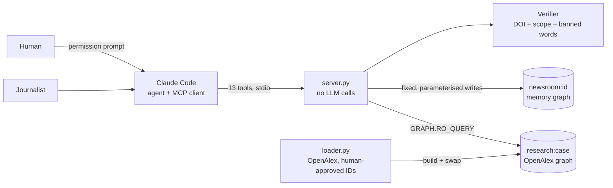

# TieTrace

*Last updated by Aaryan, Oct 17: web app section (`web/`). Earlier, Abdul, Oct 17: checkpoint 8 results (E4, E6, E8, E9, E10), architecture diagram, licence note, test status. Earlier, Aaryan, Oct 16: checkpoint 7 (verdicts, sourcing notes, the Writer subagent; 13 tools); PMI funder share now read from the graph's Meta node. Earlier the same day: rewritten to match the code after checkpoint 6 and the hardening round (both tracks, 10 tools, setup, test and evaluation results, limits).*

TieTrace helps a journalist check how connected an expert is to the company in a story. It looks the expert up in a research graph built from [OpenAlex](https://openalex.org) and stored in [FalkorDB](https://www.falkordb.com), and it answers with evidence, not opinions:

- every tie comes with the paper and its DOI;
- every "no tie found" comes with its scope: how many co-author hops, which years, and how much of the data records funders at all;
- it never calls anyone "independent" or "conflicted". It says "ties found in the research record". A missing tie is not proof, because OpenAlex is incomplete.

Built for FalkorDB Graph Hacks, Track 1 (act on connected data) and Track 2 (memory and coordination). Two research cases are loaded: **Coca-Cola × obesity** (`obesity-coke`, the main case) and **Philip Morris × lung cancer** (`philip-morris-lung`).

## What it finds

| Tier | Meaning | How to use it |
|---|---|---|
| A1 | Authored a small paper (25 authors or fewer) funded by the company, or listed a company affiliation on one | **Direct evidence**, with DOIs |
| A2 | Foundation grant, bottler affiliation, or the only evidence is a large multi-author paper | **Direct evidence**, with DOIs and the reason |
| B | 2 or more recent small papers (since 2021) with a Tier A person | Network context only, not validated (E1 failed) |
| C | Within 2-3 such co-author hops of a Tier A person | Network context only, not validated |
| NONE | Nothing above within 3 hops | "No tie found in the research record", always with its scope |

Each answer carries `tier_basis` ("direct evidence" or "network context only — not validated (E1/E2)"). The score (redesign section 4) is shown as context only: `check_case` lists Tier A1, then A2, then everyone else in the order given, and never ranks by score. Details: [tietrace-v2-redesign.md](tietrace-v2-redesign.md) and [docs/mcp-spec.md](docs/mcp-spec.md).

## How it works



- **Claude Code is the agent and the MCP client.** It reads the journalist's request and picks the tools.
- **`server.py` is a Python MCP server (stdio).** It makes no LLM calls and needs no API key. Model-facing reads use `GRAPH.RO_QUERY` with a timeout and a row cap; writes are fixed, parameterised Cypher. Every tool returns one envelope: `ok`, `data`, the `cypher` it ran, `scope`, `verdicts_applied`, `warnings`.
- **Research graph** `research:<case>`: Person, Work, Funder, Org and Topic nodes from OpenAlex, with `AUTHORED`, `FUNDED_BY`, `AFFILIATED`, `COAUTH` and `COAUTH_B` edges. Built by `loader.py`; never written by the server.
- **Memory graph** `newsroom:<id>` (Track 2): one per newsroom, picked by the `TIETRACE_NEWSROOM` env var (never a tool argument). It stores a Session per server process, an Event per tool call (with `duration_ms`), Cases and the saved Checks, linked by `SUPERSEDES` when a check is re-run.
- **Verifier** (`verifier.py`, plain code): rejects a tie claim without a stored DOI, a "no tie" claim without `query_name` and scope (hops, years, coverage, funder_coverage), and the banned words.
- **Anonymity:** experts appear as "Expert #n". Names appear only in a case whose experts are all on the case's approved public list (the documented GEBN case).

## The 13 tools

Track 1, research (read the research graph):

| Tool | What it does |
|---|---|
| `list_cases` | Which research cases exist, whether their graph is loaded, data version, counts |
| `resolve_experts` | Names from the story to OpenAlex author IDs: MATCHED, AMBIGUOUS (a human picks) or NOT_FOUND |
| `find_experts` | Active authors on a topic when the journalist names no one (company staff left out) |
| `tie_report` | One expert in detail: tier, evidence with DOIs, `tier_basis`, a ready sentence |
| `check_no_tie` | Shortest co-author path to a Tier A person (`algo.BFS`, up to 3 hops), or NO_TIE_FOUND with its scope |
| `bridges` | The strongest co-author paths to Tier A people, each link with its DOIs |
| `check_case` | Up to 25 experts in one run; with a `case_id` each result is saved as a Check |

Track 2, memory (the newsroom graph):

| Tool | What it does |
|---|---|
| `open_case` | Open a story's case with its experts; `prior_memory` shows earlier checks of them in this newsroom |
| `recall` | Timeline of an expert's checks, a case, or a session |
| `recheck` | Re-run a saved check on the current graph and show what changed and why (new data or a verdict) |
| `record_verdict` | **Human only.** Rule a paper out (`PAPER_EXCLUDED`, a DOI) or merge two author profiles (`PROFILE_MERGE`); every current check in the newsroom is re-run and the changed ones are listed (tier and score before and after) |
| `draft_note` | The Writer's tool: claims for the sourcing note, each checked by the Verifier (DOIs must be the expert's Tier A evidence, a no-tie claim gets the server's own scope, no names, no banned words) |
| `approve_note` | **Human only.** Approve a verified note and get it as markdown, every DOI as a link and every no-tie claim with its scope |

`tie_report`, `check_case`, `open_case`, `recheck`, `record_verdict`, `draft_note` and `approve_note` are marked as writing (they add Cases, Checks, Verdicts or Notes; `record_verdict` is also marked destructive because it supersedes saved checks); the others are read-only (their Event is an audit log). `record_verdict` and `approve_note` must never be allowlisted: Claude Code's permission prompt is the human gate. The Writer is a Claude Code subagent (`.claude/agents/writer.md`) limited to `recall`, `tie_report`, `check_no_tie` and `draft_note`. What a verdict does and does not recompute is listed in `docs/mcp-spec.md` section 9f. Not built (cut): `review_queue`, `set_policy`.

## Setup

You need Docker, Python 3.13 or newer, and [uv](https://docs.astral.sh/uv/).

1. **Start FalkorDB** (pinned version, AOF on so a crash loses at most about 1 s, ports bound to this machine only):

   ```bash
   docker run -d --name falkordb -p 127.0.0.1:6379:6379 -p 127.0.0.1:3001:3000 \
     -v falkordb-data:/var/lib/falkordb/data \
     -e REDIS_ARGS="--appendonly yes --appendfsync everysec" --stop-timeout 120 \
     falkordb/falkordb:v4.22.1
   ```

   Use `v4.22.1`, not `:latest`: on Oct 8 `:latest` was 6.0.2, which crashed on our data. The FalkorDB Browser is at http://127.0.0.1:3001. Next time: `docker start falkordb`. Check AOF with `docker exec falkordb redis-cli CONFIG GET appendonly` (must say `yes`).

2. **Install the Python packages:** `uv sync`

3. **Add your OpenAlex key:** `cp .env.example .env` and fill in `OPENALEX_API_KEY`. Never commit `.env`. Other settings are environment variables: `FALKORDB_PORT` (default 6379), `TIETRACE_NEWSROOM` (required by the server), `TIETRACE_CASE` (default `obesity-coke`).

4. **Build the research graph:**

   ```bash
   uv run python loader.py --rebuild                            # obesity-coke
   uv run python loader.py --case philip-morris-lung --rebuild  # second case
   ```

   With the raw cache present (`data/raw/` and `cases/<slug>/raw/`, not in the repo) this makes zero API calls. Without it, the loader downloads from OpenAlex using your key (capped per case by `max_api_calls` in `cases/<slug>/case.json`); `--refresh` forces a fresh download. The graph is built aside and swapped in, so a failed build leaves the old graph in place.

5. **Register the server with Claude Code:**

   ```bash
   claude mcp add tietrace-alpha -e TIETRACE_NEWSROOM=alpha -- uv run --directory <path-to-repo> python server.py
   ```

   Add `-e FALKORDB_PORT=...` if FalkorDB is not on 6379. The server exits at once if `TIETRACE_NEWSROOM` is unset or `TIETRACE_CASE` names no valid case. `claude mcp list` should show it Connected.

6. **Optional:** `uv run python obsidian_export.py --watch 5` writes the newsroom memory as linked notes into an Obsidian vault (read-only on FalkorDB).

## Web app

A local page for people without Claude Code (`WebApp.md`): paste a story on the left, watch each tool and its read-only Cypher on the right, and read one card per expert ("Expert #n" only) with DOIs and, for every "no tie found", its scope. A "How it works" page explains the project. It runs `claude -p` with this MCP server, so it needs a logged-in `claude` and FalkorDB running:

```bash
uv run uvicorn web.app:app --host 127.0.0.1 --port 8000   # then open http://127.0.0.1:8000
```

`TIETRACE_NEWSROOM` (default `alpha`) and `FALKORDB_PORT` work as for the server. The model gets no built-in tools and never `record_verdict` or `approve_note`; those run only from a button on the page with a second confirm. Tests: `uv run python tests/test_web.py`.

**Agent mode (Gemini, OpenAI, Claude with the visitor's own key):** `POST /api/agent/ask` takes the key only in the `X-Provider-Key` header and never stores or logs it. Run the same command as above (uvicorn's access log shows the request line only, never headers; add `--no-access-log` to be extra safe). Optional env: `TIETRACE_HOST_GEMINI=1` lets Gemini use the host's `GEMINI_API_KEY` when the visitor sends no key (off by default); on a hosted copy set `TIETRACE_DEPLOYED=1` and `TIETRACE_ALLOWED_ORIGIN=https://your.site` (requests without `X-Forwarded-Proto: https`, or marked `http`, are refused: run it behind a TLS proxy that sets this header, because the key travels in a header). Tests: `uv run python tests/test_agent.py`.

## Tests

Plain-assert scripts, no pytest. They need FalkorDB with both research graphs loaded, use scratch `zz-test-*` newsrooms (never `alpha`) and delete them at the end:

```bash
for s in test_loader test_research test_server test_eval test_cases test_discover test_memory test_obsidian test_notes test_golden test_concurrency test_isolation; do
  uv run python tests/$s.py
done
```

New in checkpoint 8 (Abdul, Oct 17, FalkorDB v4.22.1 on port 6381): `test_golden` 15/15, `test_concurrency` 1/1, `test_isolation` 1/1, `test_eval` 15/15; `test_loader` 49/49, `test_server` 26/26, `test_cases` 27/27, `test_notes` 40/40.

Last full run (Aaryan, Oct 16, after checkpoint 7, FalkorDB v4.22.1, Python 3.14): loader 49/49, research 54/54, server 26/26, eval 13/13, cases 27/27, discover 26/26, memory 32/32, obsidian 22/22, notes 39/39. `test_memory` and `test_research` also pass on Python 3.13.

## Evaluation results

Full method and numbers: [eval/results.md](eval/results.md). Pass rules were fixed before the runs and not changed after.

| Test | Result |
|---|---|
| E7 coverage | Of the 30,140 loaded topic works, **56.3%** list a funder and 96.6% list a funder or an affiliation (affiliation says little about funding). The topic part is a per-year sample of the most-cited works: about 11.5% of the field. |
| E3 known case (GEBN) | **4 of 4** publicly confirmed GEBN leaders found as Tier A with DOIs (Blair and Hand A1, Hill and Peters A2 via the Coca-Cola Foundation). A fifth name could not be confirmed from a public source, so the "all five" rule is not testable. |
| E1 placebo lift (Tier B) | **FAIL.** Lift 0.96x (interval 0.84-1.09) against works-count-matched random groups: Tier B is not a sign of unusual closeness. |
| E2 temporal hold-out | **FAIL.** The weighted score (AUC 0.716) does not beat publication volume (0.720) or a plain count of Tier A co-authors (0.749). The score does not predict later ties. |
| E11 memory across sessions | Passed in real Claude Code: a fresh session's `open_case` showed the earlier session's check. |
| E4 max flow vs path sum | Ranks differently (Spearman 0.86; 0.73 within 3 links; top-10 overlap 6 of 10), but flow ignores the 3-link limit, needs whole-number capacities, and neither ranking is validated. Not used for any finding. |
| E6 mega-paper ablation | Without the 25-author cap A1 would grow from 949 to 1,069 people and Tier B from 1,309 to 1,889; 23.7% of A1+B people exist only through big papers. The cap is kept. |
| E8 golden tests | 15 of 15 pass (the four public GEBN names, a profile merge, a verdict changing a score, the Verifier rejecting a claim without a DOI, a write refused by `RO_QUERY`). |
| E9 concurrency | Two server processes checking and ruling at the same time (overlap verified): nothing lost; every current check equals a fresh rerun. |
| E10 tenant isolation | All 13 tools tried with another newsroom's ids: nothing visible. |
| E5 profile hand-check | **Cut.** A random sample of 50 is in `eval/e5_sample.md`, but nobody has hand-checked it, so we claim no error rate. |
| 5f second case (Philip Morris × lung cancer) | End to end in Claude Code with correct scope wording; only 37.5% of that graph's topic works list any funder (7,482 of 19,964, read from the graph's `Meta` node), so "no tie found" is weaker there. |

Because E1 and E2 failed, only Tier A is a finding. Tier B, Tier C and the score are shown as labelled network context.

## Honest limits

- **Funding data is thin.** Only 56.3% of loaded obesity topic works list any funder (37.5% in the Philip Morris graph), so "no tie found" often means "no funding recorded". Every no-tie answer quotes the graph's funder share and the expert's own share of works with a funder.
- **The graph is a sample.** The topic part holds the most-cited works per year (about 11.5% of the field); co-authors' other works are not loaded, so ties through unloaded papers are invisible.
- **Split author profiles.** OpenAlex sometimes splits one person into several records; a check on the "wrong" record can miss evidence (see E3 in `eval/results.md`). A human can merge two profiles with a `PROFILE_MERGE` verdict (evidence and co-author links are combined for either id; `bridges` still starts from one id).
- **Gifts to universities** and other money that OpenAlex funder fields do not record are invisible.
- **Tier C saturates in some fields** (52 of 73 top lung cancer authors in the 5f run, session-reported and not yet re-checked by a script), so it may say little there.
- **Profile merge/split error rate is unknown** (E5 cut).
- **Test status:** on a fresh Windows setup (Abdul, Oct 17) 6 older tests in `test_discover` and 6 in `test_obsidian` fail from Windows issues (UTF-8 file reads, SIGINT), `test_research` has one cold-start timing miss (3-hop bridges on the biggest hub, 4.2 s vs 3 s) and `test_memory` needs the Philip Morris graph loaded. Aaryan's run on Oct 16 was all green.

## Files

| File | What it is |
|---|---|
| `server.py` | The MCP server: 13 tools, the envelope, the Event log |
| `research.py` | Research queries (tiers, no-tie BFS, bridges, name lookup) |
| `memory.py` | The newsroom memory graph (Sessions, Events, Cases, Checks, Verdicts, Notes) |
| `verifier.py` | Claim checker |
| `loader.py` | Builds a research graph from OpenAlex (`cases/<slug>/case.json`) |
| `discover.py` | CLI to find OpenAlex IDs for a new case (a human approves them) |
| `obsidian_export.py` | Exports the memory graph to Obsidian |
| `eval/` | Evaluation scripts and `results.md` |
| `tests/` | Plain-assert test suites |
| `docs/mcp-spec.md` | Tool contract and diagrams |
| `tietrace-v2-redesign.md` | Design: tiers, graph model, queries, evaluation plan |
| `checkpoints.md`, `AI_USE.md` | Progress and who did what; log of AI help |

## Team and AI use

Abdul and Aaryan. Most code was written with Claude Code in a Builder/Reviewer loop; [AI_USE.md](AI_USE.md) logs what the AI wrote and what we verified, and [checkpoints.md](checkpoints.md) records who did each step.

## Data and licences

- Research data: OpenAlex, released under **CC0**.
- FalkorDB is used as a separate, unmodified Docker image; FalkorDB is licensed under the Server Side Public License v1 (SSPLv1) (checked on its Docker Hub and GitHub pages, Oct 17). We do not redistribute it.
- Licence for this code: **not chosen yet**.
