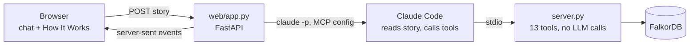

# TieTrace web app: design plan

*Last updated by Abdul, Oct 17 2026: first version, from the brainstorming session with Claude Code (layout and look chosen by Abdul in mockups).*

**This is the file to follow for the web app.** `checklist_phase2.md` section P2-W points here. Items marked **(Abdul decided)** were chosen by Abdul in the brainstorm; items marked **(Claude's default)** are proposals nobody has agreed to yet; change them freely.

## 1. Why

Judges and other people should be able to see and use TieTrace without Claude Code and without reading the README. The web app is a **visual front door** to the same pipeline that runs today in MCP mode. It adds no new analysis and changes no tool or rule.

## 2. Goals, non-goals, anti-goals

**Goals**
- A reporter pastes a story into a chat box and the whole pipeline runs on it (Abdul decided).
- The right side shows the pipeline working: which tools ran, and the exact read-only Cypher (Abdul decided).
- A separate "How It Works" page that explains the project to a journalist, using only real numbers (Abdul decided).
- Runs **locally** next to FalkorDB, for judges to see everything (Abdul decided).
- A **deployable version** with a free-tier hosted model is planned now but built last (Abdul decided).

**Non-goals**
- No accounts, no database of its own, no user history beyond the existing newsroom memory graph.
- No new analysis, tiers or tools; no editing of data.
- No public hosting in phase A.

**Anti-goals (would make it a failure even if it works)**
- Anything that makes a tie sound like a verdict. Banned words in all page copy and replies: "independent", "conflicted". Say "ties found in the research record".
- Real names of non-public experts. They appear as "Expert #n" exactly as in the tools.
- A "no tie found" shown without its scope (hops, years, funder coverage).
- A web endpoint the model can call that records a verdict or approves a note without a human click.
- Showing a number that is not in the README or `eval/results.md`.

## 3. What the user sees

### 3.1 Chat page (Abdul decided: layout B, dark look)
- Left: chat. The reporter pastes a story; replies appear as one card per expert with a **tier chip** (A1, A2, B, C, NONE), the DOIs as links, and for any NONE the scope line. No thick coloured side borders (a known generic look); use a chip and a quiet tint.
- Right: **live evidence panel**: pipeline steps as they run (`resolve_experts`, `check_case`, `check_no_tie`, ...), and the exact Cypher each tool returned in its envelope (`cypher` field), in a monospace block.
- "Try an example" buttons: Coca-Cola × obesity (GEBN) and Philip Morris × lung cancer.
- Ambiguous names: the chat shows the candidates and asks the reporter to pick (same as MCP mode).
- Company or topic with no loaded graph: the chat says so plainly and points to the "How It Works" page; it does not guess (Claude's default).
- **Approve** buttons for the human-only steps (`record_verdict`, `approve_note`). See open decision O2.
- A fixed one-line footer: "Ties found in the research record. A missing tie is not proof."

### 3.2 "How It Works" page (Abdul decided: dark graph-motif hero)
Hero line: "Every tie has a DOI. Every 'no tie' has a scope." with a small node-and-edge drawing. Sections, in order (Claude's draft; reorder freely):
1. The problem: a story quotes a scientist; was their work funded by the company?
2. The four steps: paste story → names resolved → ties checked in the graph → answer with DOIs and scope.
3. What the tiers mean: A1 and A2 are direct evidence; B and C are network context only.
4. Why "no tie found" is never bare: hops, years, funder coverage (56.3% in the Coca-Cola graph, 37.5% in Philip Morris).
5. What we tested, honestly: E3 passed; E1 and E2 failed, so only Tier A is a finding; E6, E8, E9, E10 results. Numbers are copied from `eval/results.md`, never retyped from memory.
6. Who decides: verdicts and approvals are human clicks.
7. Limits: thin funding data, split profiles, the graph is a sample, gifts to universities are invisible.
8. For judges: the 13 tools, the read-only query rule, a link to the GitHub repo and `docs/mcp-spec.md`.

## 4. How it works inside (Claude's default, not yet agreed)

- **Backend:** a small FastAPI app in `web/`, started with one command. It runs `claude -p` with a generated MCP config that points at the existing `server.py`, and streams the steps to the browser.
- **Frontend:** plain HTML, CSS and JavaScript in `web/static/`, **no build step**, so both authors can read every file.
- **Streaming:** server-sent events (built into browsers).
- **Why this way:** least new code, same behaviour as MCP mode today, `CLAUDE.md` already allows `claude -p` for scripted LLM steps, and the server still holds no key.
- **Known risk:** `claude -p` needs a working Claude login. It failed once on this project with "OAuth session expired". The web app must show a clear message when this happens (see task W3).

## 5. Build order

Phase A is local; phase B (deployable) goes **last** (Abdul decided).

| Step | What | Done when |
|---|---|---|
| W1 | Static shell: both pages, dark theme, hero, example buttons, no backend | Both pages open from a file; looks match the chosen mockups |
| W2 | "How It Works" content with real numbers | Every number traces to `README.md` or `eval/results.md`; no banned words |
| W3 | Backend: `POST /api/ask` runs `claude -p`, streams events; clear error when the login is expired or FalkorDB is down | The Coca-Cola example returns the same tiers as MCP mode |
| W4 | Chat UI: expert cards, tier chips, scope lines, evidence panel with Cypher | Ambiguous names let the reporter pick; "Expert #n" only |
| W5 | Human gates: Approve buttons | See O2; the model cannot trigger them |
| W6 | Tests and review | Builder/Reviewer loop; tests listed in section 7 |
| W7 | Deployable version: free-tier hosted model instead of `claude -p`, request limits, no write tools exposed | Planned in section 6; built only after W1-W6 and checkpoint 9 |

## 6. Phase B: deployable version (planned now, built last)
- Swap only the "reader and writer" step: a free-tier hosted model drives the same tools through the same MCP server. The tools and rules do not change.
- A per-visitor request limit and a daily cap, so the free tier is not exhausted.
- No write tools exposed to anonymous visitors: `record_verdict`, `approve_note` and any case creation are off; read tools only.
- Read-only FalkorDB access (separate Redis user is the `IMPROVEMENT.md` P2-1 item) and no OpenAlex key on the host.
- Cut first if time is short.

## 7. Tests (each task owns its test)
- Pages contain none of the banned words ("independent", "conflicted") and no number that is missing from `README.md` or `eval/results.md`.
- A non-public expert never appears with a real name in the HTML or the event stream.
- A no-tie card always carries hops, years and funder coverage.
- Expired login and FalkorDB down both give a readable message, not a stack trace.
- The page cannot call `record_verdict` or `approve_note` without a human click (see O2).
- The Coca-Cola example in the web app gives the same tiers as `tests/test_golden.py` expects (Blair A1, Hill A2).

## 8. Open decisions (need Abdul and Aaryan)
- **O1.** Backend and frontend defaults in section 4: accept, or choose differently?
- **O2.** `approve_note` and `record_verdict` ask a permission prompt in Claude Code. `claude -p` cannot show a prompt, so the web app needs its own human gate. Proposal: the **Approve** button calls the server function directly after an on-page confirmation, and the model never gets those tools in the web session. Needs agreement because it moves the gate from Claude Code to the page.
- **O3.** What a reporter sees for non-public experts' names: always "Expert #n", or a "show names" toggle that only works in the GEBN public case (as in MCP mode)?
- **O4.** Where the files live: `web/` in the repo root (Claude's default).
