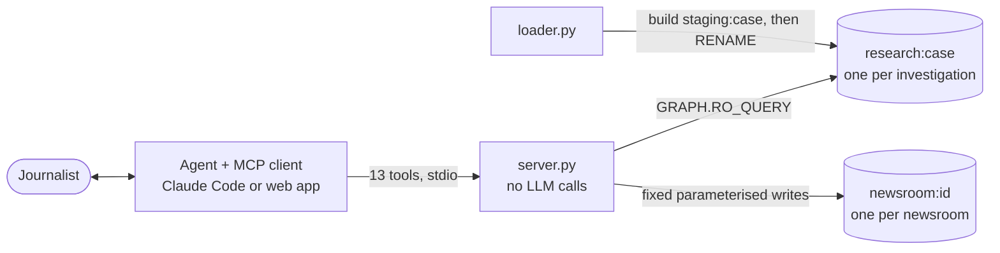

# One Database, Many Graphs

### Running read-only research graphs and private newsroom memory side by side in FalkorDB

*By Aaryan Degama, Abdul, Kavyan and Jalendu, TieTrace team, for FalkorDB Graph Hacks (Tracks 1 and 2). Oct 18, 2026. Every number here comes from our test suites, evaluation scripts or FalkorDB's own counters; the source is named where it matters.*

---

TieTrace answers one question for journalists: *what ties does the research record show between this expert and this company?* Our [first post](https://github.com/Aaryan-Degama/TieTrace/blob/main/BLOG1.md) covered what the tool finds and how we evaluated it. This one is about the database underneath: how we keep several large research graphs and every newsroom's private memory in one FalkorDB instance, swap a graph while it is being read, and keep an AI agent from writing anything it should not.

## The shape of the system

The server is a Python MCP server with 13 tools and no model calls. The agent (Claude Code, or our web app with the visitor's own Claude, Gemini or OpenAI key) decides which tool to call; Cypher does all the work on the data. Every tool returns the exact Cypher it ran, so any answer can be replayed.

## Two kinds of graph in one instance

FalkorDB keeps many named graphs in one server. We use two kinds.

**Research graphs, `research:<case>`**, one per investigation, built from [OpenAlex](https://openalex.org) (CC0). Nodes: `Person`, `Work`, `Funder`, `Org`, `Topic`. Edges: `AUTHORED`, `FUNDED_BY`, `AFFILIATED`, `PARENT_OF`, `COAUTH`, `COAUTH_B`. The agent can only read them.

| | Coca-Cola × obesity | Philip Morris × lung cancer | Nestlé × infant formula |
|---|---|---|---|
| Works | 31,291 | 21,756 | 28,044 |
| People | 85,511 | 68,723 | 73,961 |
| Co-author edges (both directions) | 1,326,194 | 1,458,502 | 3,915,672 |
| Size reported by `GRAPH.MEMORY USAGE` | 784 MB | 726 MB | 1,785 MB |

*Counts from each graph's `Meta` node, written at build time. The Nestlé graph was built on Oct 18.*

**Newsroom graphs, `newsroom:<id>`**, one per newsroom, holding the agent's memory: a `Session` per server process, an `Event` per tool call, `Case` and `Check` nodes, human verdicts and approved notes. A re-run check links to the old one with `SUPERSEDES`, so history is never overwritten. Unlike research graphs, these cannot be rebuilt from anything, which shapes how we back them up (below).

## Isolation in three layers

Putting every newsroom in one database is only safe if one newsroom can never see another's memory. We enforce that three times.

1. **The model never names a graph.** The newsroom id comes from the `TIETRACE_NEWSROOM` environment variable when the server starts, never from a tool argument. Our isolation test called all 13 tools with another newsroom's ids: every call returned zero rows or `NOT_FOUND`.
2. **The engine refuses writes.** Every query the model can trigger goes through `GRAPH.RO_QUERY` with a timeout and a row cap. A `CREATE` on that path fails inside FalkorDB, so safety does not depend on our prompt.
3. **A Redis ACL user can be limited to `research:*`.** We tested this on a throwaway container: a `reader` user with `~research:*` and only read-only graph commands can query research graphs, while `GRAPH.QUERY`, `GRAPH.DELETE` and any query on `newsroom:*` return `NOPERM`. One surprise: `GRAPH.LIST` still shows the `newsroom:*` *names* to that user, just not their contents. The live server does not use this user yet, because it writes newsroom memory.

## Swapping a graph while people read it

A research graph is rebuilt whenever its case changes. We never want a reporter to see a half-built graph, so the loader builds into `staging:<case>`, runs a self-check, and only then runs Redis `RENAME` over the live name. A failed build leaves the old graph untouched. From the download cache, the Coca-Cola graph rebuilds in about 60 seconds with zero API calls.

What happens to queries already running during the swap was not documented, so we tested it (`tests/test_rename_swap.py`). On FalkorDB 4.22.1, `RENAME` returned in about 0.5 ms while reads were still running; those reads finished on the old graph, and the next read saw the new one. No reader saw a mix.

## Budgeting memory for many graphs

FalkorDB keeps every graph in RAM, so a third or fourth case is a memory question before it is anything else. Three things surprised us.

- **`GRAPH.MEMORY USAGE` overstates.** The first two graphs reported 784 + 727 MB, but Redis `used_memory` for both together was 1.19 GiB. We use the reported size as a safe upper estimate.
- **`total_system_memory` is not your budget.** With `maxmemory` unset, Redis reports the whole machine: 15.01 GiB on one of our laptops, which had about 3.98 GiB actually free. So before a build the loader checks two things: used memory plus the new graph against 90% of the limit, and the new graph against Linux `MemAvailable`. The real guard is setting `maxmemory`, after which Redis refuses writes past it.
- **`GRAPH.COPY` copies in RAM.** It works on 4.22.1 and keeps indexes, but copying a research graph needs its full size free again. So we would only ever copy a small newsroom graph that way.

Idle research graphs can simply be deleted with `GRAPH.DELETE` and rebuilt later from the cache for free. Newsroom graphs are the opposite: we never delete them, and we back them up from the volume after a `SAVE`.

## Persistence

A Docker shutdown once interrupted FalkorDB's final snapshot, and it came back with an older one. We turned on the append-only file (`appendonly yes`, `appendfsync everysec`), which bounds a crash to about one second of writes. On one restart, the container log showed "DB loaded from append only file: 4.802 seconds". Before closing Docker we now run `redis-cli SAVE`, then stop with a 120-second timeout.

## The queries doing the real work

- **Corporate families with variable-length paths.** An affiliation with a Coca-Cola bottler should still count, so ownership is stored as `PARENT_OF` edges (from OpenAlex, ROR, Wikidata and GLEIF, each approved by a human) and matched with `[:PARENT_OF*0..3]` from the parent company down.
- **"No tie found" with `algo.BFS`.** A breadth-first search over co-author edges, up to three hops, looking for anyone with direct ties. If nothing is reached, the answer carries its scope: hops, years, and the share of papers that list any funder. Median over eight experts: 9.3 ms.
- **Strongest paths with `bridges`.** Our slowest query: 1.5 s on a first call and 1.2 s cached on a warm server, but 4.2 s once on a freshly started container.

## Four quirks worth knowing

1. **Undirected matches can count inconsistently.** `()-[r]-()` gave us 3 edges where `(a:P)-[r]-(b:P)` gave 6. We store co-authorship in both directions and always match with `->`.
2. **Results cap at 10,000 rows silently.** Count inside Cypher, never by counting returned rows.
3. **`UNWIND` then traverse can skip the index.** `WHERE x.id IN $ids` keeps it.
4. **On 4.22.1, `OPTIONAL MATCH ... WITH d WHERE d IS NULL` does not filter.** For "write only if absent", use `WITH count(d) AS n WHERE n = 0`.

## Why one graph database

Every question TieTrace asks is a relationship question: who funded this paper, who wrote it with whom, which company owns which bottler, which expert sits two co-authors from a funded one. In a graph each is a pattern you can read aloud.

The bigger win was keeping everything in one place without mixing it up. Read-only research graphs and private newsroom memories share one server, separated by name and enforced by the engine. That let us give an AI agent real access to real data without handing it the keys.

---

*Code (MIT): [github.com/Aaryan-Degama/TieTrace](https://github.com/Aaryan-Degama/TieTrace). Install with `./install.sh`; the README lists every step.*
