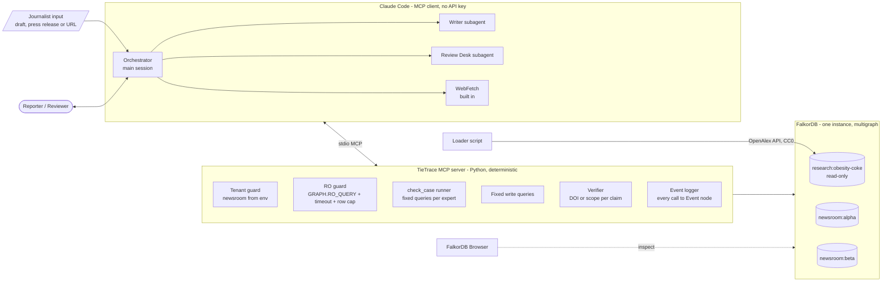
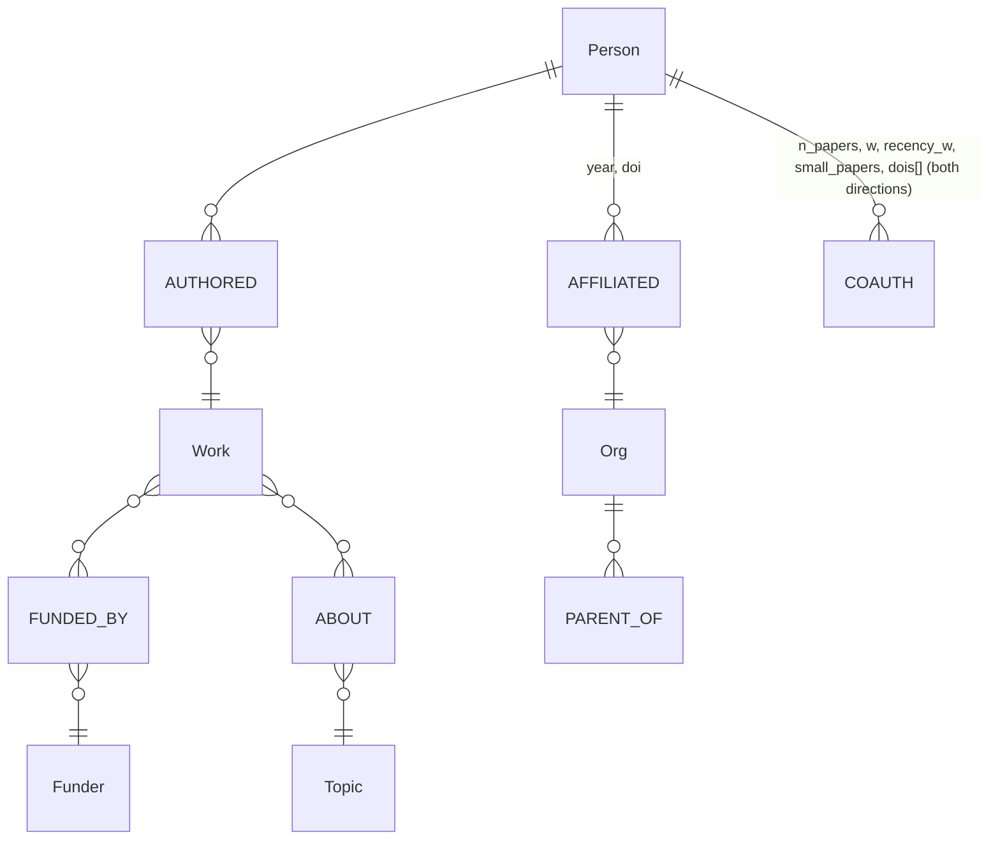
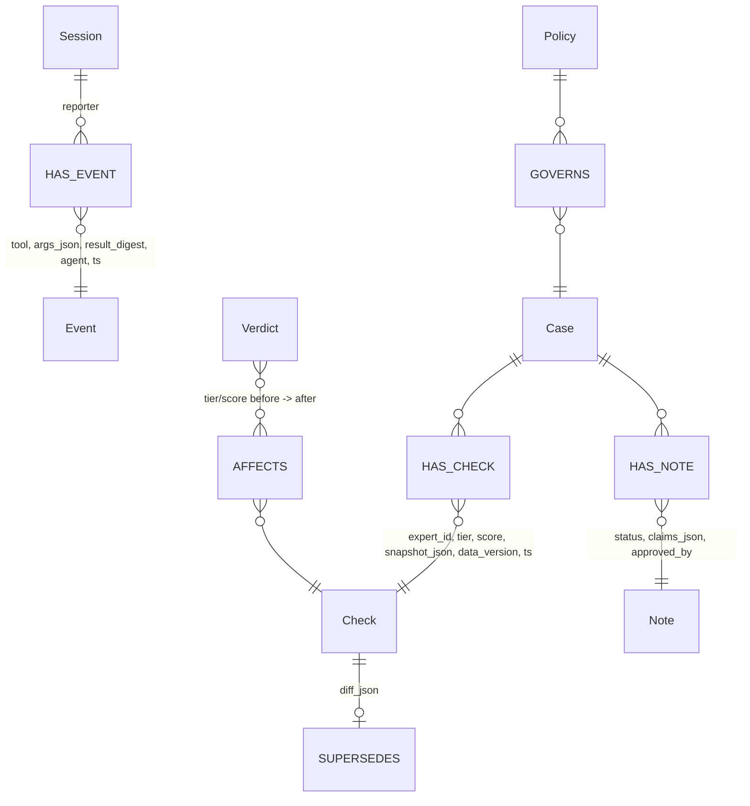
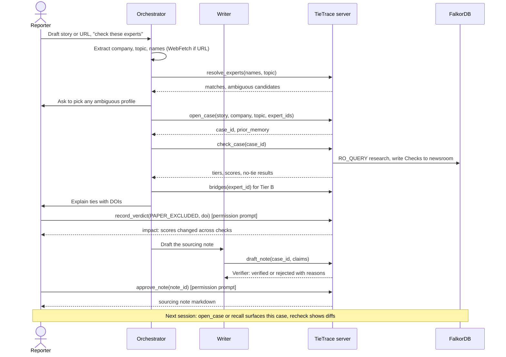
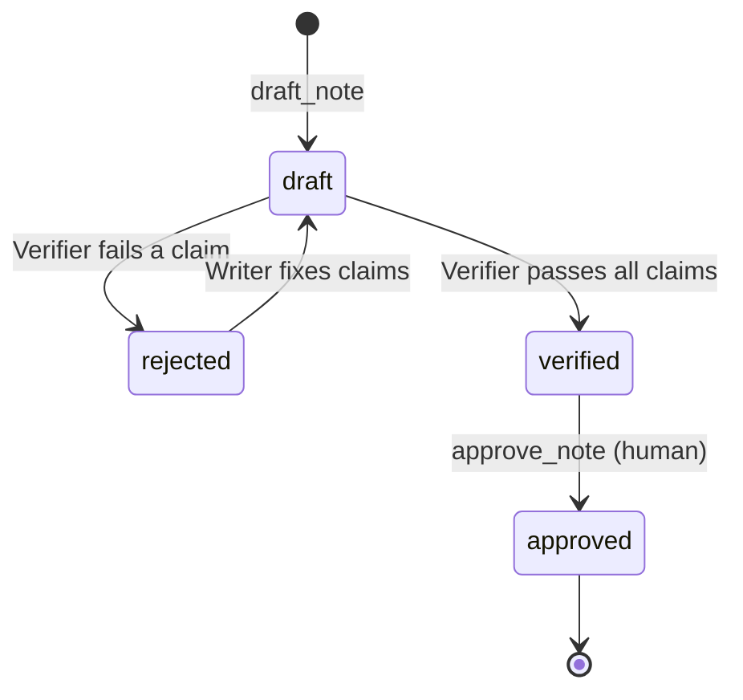

# TieTrace MCP spec (Tracks 1 & 2)

*Last updated by Abdul, Oct 15: checkpoint 3 (review fixes applied, round 3: non-paper records flagged not dropped, bridges time budget; error codes, name lookup, junk rule, coverage wording), `research.py` and `verifier.py` written; section 9 lists where the code adds to or differs from this contract (decided by Abdul). Earlier: team attribution convention (see CLAUDE.md). Past content authored in Abdul's sessions.*

## Context
Graph Hacks (FalkorDB, Oct 15-18 2026). `tietrace-v2-redesign.md` fixes the data model, tiers and evaluation. This file defines every MCP tool (inputs, outputs, errors, which graph it touches, read or write) and diagrams the whole system, so the code can be written straight from it.

Hard rules:
- The server makes **no LLM calls**. Claude Code is the client; it reads the journalist's input and picks tools.
- Every read the model can trigger runs through `GRAPH.RO_QUERY`. Writes are fixed, parameterised queries.
- Every answer includes the Cypher it ran.
- Output never says "independent" or "conflicted".

### Who does what
| Part | Is | Job | Why here |
|---|---|---|---|
| **Orchestrator** | The main Claude Code session | Reads the journalist's input (pasted text, or a URL via Claude Code's built-in WebFetch), extracts company, topic and expert names, calls tools, explains results, asks the human for rulings | Needs judgment, so it needs an LLM. "Tool selection through MCP" is a Track 1 judging point |
| **Writer** | Claude Code subagent (`.claude/agents/writer.md`) | Drafts the sourcing note from saved Checks | Needs language. Its draft is checked by the Verifier |
| **Review Desk** | Claude Code subagent (stretch) | Reads `review_queue` and suggests which paper or profile to rule on first | Needs judgment |
| **Tie-checking** | Server tool `check_case` | Runs the fixed queries for every expert in a case | Deterministic: no LLM needed, so it does not get an agent |
| **Verifier** | Plain code in the server | Blocks claims without a DOI or scope | Must be deterministic |
| **Human** | Reporter or reviewer | Records verdicts, approves notes | The human makes the final call |

No crawler is built. Research data comes from the OpenAlex API. Journalist URLs are fetched with WebFetch; add the Firecrawl MCP server only if WebFetch fails on a page.

---

## 1. How it fits both tracks

| Track | What TieTrace shows | Tools |
|---|---|---|
| **1: Act on connected data** | The LLM picks graph tools. Multi-hop tie finding, `algo.BFS` for the no-tie proof, bridge paths with DOIs, max flow at depth 3 | `resolve_experts`, `find_experts`, `check_case`, `tie_report`, `check_no_tie`, `bridges` |
| **2: Memory and coordination** | **Episodic** memory: Session, Event and Check records. **Semantic**: Verdict facts. **Procedural**: a Policy node. **Shared state**: the orchestrator, the Writer and every reporter in a newsroom read and write the same newsroom graph. **Concurrency**: several reporter sessions at once. **Tenants**: one graph per newsroom | `open_case`, `recall`, `recheck`, `record_verdict`, `review_queue`, `draft_note`, `approve_note`, `set_policy` |

---

## 2. Architecture



Tenant rule: the server is started with `TIETRACE_NEWSROOM=alpha`. No tool takes a newsroom argument, so the model has no way to reach another tenant. The demo registers two servers (`claude mcp add tietrace-alpha ...` and `tietrace-beta`).

---

## 3. Graph schema

Research graph `research:<topic>` (as defined in redesign section 4):



Memory graph `newsroom:<id>`:



| Memory type | Node(s) | Written by | Read by |
|---|---|---|---|
| Episodic: what happened | `Session`, `Event`, `Check` | every tool call (logger), `check_case`, `tie_report` | `recall`, `open_case`, `recheck` |
| Semantic: facts learned | `Verdict` (`PAPER_EXCLUDED`, `PROFILE_MERGE`) | `record_verdict` | all scoring queries, passed in as exclusion params |
| Procedural: how this newsroom checks | `Policy` (single node) | `set_policy` (human) | every research tool, for its defaults |
| Shared state | `Case`, `Check`, `Note` | orchestrator, Writer, other reporters | everyone in the newsroom |

---

## 4. Shared conventions

**IDs.** `expert_id` is the OpenAlex author ID (`A5023888391`). Other IDs are server-generated ULIDs with a prefix: `case_…`, `chk_…`, `vrd_…`, `note_…`.

**Anonymity.** Outputs give `label: "Expert #3"`, stable within a case. A `name` appears only when `case.public_case = true` (the documented GEBN case).

**Envelope.** Every tool returns:
```json
{
  "ok": true,
  "data": { },
  "cypher": [{"graph": "research:obesity-coke", "query": "MATCH …", "params": {}}],
  "scope": {"hops": 3, "years": "2021-2026", "coverage": 0.61, "load_scope": "…"},
  "verdicts_applied": ["vrd_…"],
  "warnings": ["profile_flag=no_orcid"]
}
```
On failure: `{"ok": false, "error": {"code": "...", "message": "..."}}`.
Error codes: `INVALID_ARG`, `NOT_FOUND`, `AMBIGUOUS`, `TIMEOUT`, `ROW_LIMIT`, `VERIFIER_REJECT`, `NOT_APPROVED`, `READ_ONLY`, `DB_ERROR` (any other database or connection error; added by Abdul, Oct 15).

**Defaults** come from `Policy`: `hops=3`, `years=5`, `author_cap=25`, `show_tier_c=true`, `row_limit=500`, `timeout_ms=3000`.

**Logging.** Every call writes one `Event` (tool name, args, a digest of the result, `agent`, timestamp) under the current `Session`. Each tool accepts an optional `agent` string (for example `"writer"`) for attribution.

---

## 5. Tools

### Track 1: research tools (read-only on `research:*`)

**`resolve_experts`**: names from the journalist's input to OpenAlex IDs
- In: `names: str[]`, `topic: str`
- Out: `data.matches[]: {name_in_input, status: "MATCHED" | "AMBIGUOUS" | "NOT_FOUND", expert_id | null, candidates[]: {expert_id, works_on_topic, orcid, last_known_org}}`
- Ranks candidates by works on the topic. For `AMBIGUOUS`, the orchestrator asks the human to pick and never guesses.

**`find_experts`** (Q1): when the journalist names no one
- In: `topic: str` (OpenAlex topic ID or a text query), `n: int = 20` (max 100), `exclude_target_staff: bool = true`
- Out: `data.experts[]: {expert_id, label, works_on_topic, works_count, profile_flag}`, `data.topic: {id, name}`
- Cypher: full-text index on `Work.title`, then aggregate authors over `ABOUT`.

**`check_case`**: the deterministic batch run (writes Checks)
- In: `case_id`
- For each expert in the case it runs `tie_report`, plus `check_no_tie` when the tier is `NONE`, and saves a `Check`. Runs sequentially.
- Out: `data.results[]: {label, expert_id, tier, score, check_id, no_tie: "NO_TIE_FOUND" | "TIE_FOUND" | null}`, `data.counts: {A1, A2, B, C, NONE}`. Ranked by tier, then score.

**`tie_report`** (Q2): one expert in detail
- In: `expert_id: str`, `case_id: str | null`. If `case_id` is set, the result is also saved as a `Check`.
- Out:
```json
{"expert_id": "A…", "label": "Expert #3", "tier": "A1|A2|B|C|NONE", "score": 112.4,
 "evidence": [{"kind": "FUNDED_BY|AFFILIATED", "doi": "10.…", "year": 2014, "n_authors": 6,
               "via": "The Coca-Cola Company", "family_path": ["Coca-Cola Foundation", "The Coca-Cola Company"]}],
 "coauth_ties": [{"to_label": "Tier-A #2", "n_papers": 3, "w": 1.25, "dois": ["…"]}],
 "profile_flag": "ok", "wording": "OpenAlex records Expert #3 as author of a work funded by …",
 "check_id": "chk_…|null"}
```

**`check_no_tie`** (Q3, `algo.BFS`)
Renamed from `prove_independence` because the output must never use the word "independent".
- In: `expert_id`, `k: int = policy.hops` (1-3), `years: int = policy.years`
- Out: `data.result: "NO_TIE_FOUND" | "TIE_FOUND"`, `data.nearest: {tier_a_label, hops} | null`, `data.query_name: "q3_bfs_v1"`. The `scope` block is required here; the Verifier rejects the answer without it.
- Wording: "No Tier A or B tie and no one within 3 co-author hops (2021-2026; 56% of topic works have funder data and 97% have funder or affiliation data). Absence is not proof." Both numbers are always stated.

**`bridges`** (Q4)
- In: `expert_id`, `depth: 2 | 3 = 2`, `limit: int = 5`
- Out: `data.paths[]: {nodes: [label…], edges: [{dois[], w}], strength}`, `data.bridge_count`, and `data.max_flow: float | null` (depth 3 only; E4 decides whether this stays).

### Track 2: memory tools (`newsroom:<env>`)

**`open_case`**
- In: `story: str`, `company: str`, `topic: str`, `expert_ids: str[]`, `public_case: bool = false`
- Writes: a `Case`, with experts stored in it.
- Out: `data.case_id`, `data.experts[]: {expert_id, label}`, and **`data.prior_memory[]`**: earlier Checks and Verdicts on these experts from other cases or other reporters ("Expert #3 was checked 2026-10-16 in case 'Sugar tax', tier B"). This is where cross-session recall shows up.

**`recall`**: episodic and semantic lookup
- In: one of `expert_id | case_id | session_id`, `limit: int = 20`
- Out: `data.timeline[]: {ts, kind: "check|verdict|event|note", summary, ref_id}`, ordered by time.

**`recheck`**
- In: `check_id`
- Out: `data.before: {tier, score, data_version}`, `data.after: {…}`, `data.diff: {new_evidence[], removed_evidence[], cause: "new_data|verdict|policy"}`. Writes a new `Check` linked by `SUPERSEDES`.

**`record_verdict`** (Q5): human-only. Claude Code's permission prompt is the gate; never allowlist this tool.
- In: `type: "PAPER_EXCLUDED" | "PROFILE_MERGE"`, `target: str` (a DOI, or an `[oa_id, oa_id]` pair), `reason: str`, `reviewer: str`
- Out: `data.verdict_id`, `data.impact: {experts_changed, checks_changed, details[]: {label, case_id, tier_before, tier_after, score_before, score_after}}`. Writes `AFFECTS` edges.

**`review_queue`** (Review Desk; stretch)
- In: `limit: int = 3`
- Out: `data.items[]: {kind: "paper|profile_pair", target, would_change: int, cases: [case_id]}`

**`draft_note`** (Writer, then the Verifier runs automatically)
- In: `case_id`, `claims[]: {expert_id, text, evidence_refs: [doi | query_name]}`
- Verifier rules: a positive claim needs every DOI to exist as a stored edge on that expert. A "no tie" claim needs `query_name` plus `scope` with hops, years and coverage. The banned words "independent" and "conflicted" are rejected.
- Out: `data.note_id`, `data.status: "verified" | "rejected"`, `data.rejections[]: {claim_index, reason}`

**`approve_note`**: human-only (gated by the permission prompt)
- In: `note_id`, `reviewer`
- Out: `data.markdown` (the sourcing note and disclosure line). Fails with `NOT_APPROVED` if the note's status is not `verified`.

**`set_policy`** (procedural memory; stretch): human-only
- In: any subset of `{hops, years, author_cap, show_tier_c}`
- Out: `data.policy`, and `data.affected_checks: int` (those checks are then flagged for `recheck`).

---

## 6. End-to-end flow



Note lifecycle:


---

## 7. New evaluation rows (added to redesign section 7)
- **E9 concurrency:** two reporter sessions on the same newsroom each run `check_case` on 10 experts and record verdicts at the same time. Pass: every Check and Verdict is stored, none are lost, and each impact report matches a fresh rerun.
- **E10 tenant isolation:** a server with `newsroom=alpha` cannot read beta's Checks through any tool. Pass: 0 rows.
- **E11 cross-session memory:** open a new Claude Code session and `open_case` on an overlapping expert. Pass: `prior_memory` is not empty.

## 8. Must-ship vs cut
- **Must ship:** `resolve_experts`, `find_experts`, `check_case`, `tie_report`, `check_no_tie`, `bridges`, `open_case`, `recall`, `recheck`, `record_verdict`, `draft_note`, `approve_note`, the envelope, the Event log, the Writer subagent.
- **Cut first:** `set_policy` (keep Policy as a seeded node), `review_queue` and the Review Desk, `max_flow` in `bridges`.

---

## 9. Checkpoint 3 notes: where `research.py` and `verifier.py` add to this contract
*Last updated by Abdul, Oct 15 (decided by Abdul).* The tool names, envelope and error codes are unchanged. The functions take plain Python arguments; the MCP wrapper in `server.py` (checkpoint 5) maps tool arguments onto them.

- **Arguments not in section 5:** `tie_report`, `check_no_tie` and `bridges` also take `label` (the stable "Expert #n" from the case; default "Expert #1") and `public_case` (default false; true puts the name in the label). These are plain function arguments only: the checkpoint-5 MCP wrapper must derive them from the case (`open_case`, `public_case` flag) and must NOT expose them as tool arguments. Wrong types (a bool or string where an integer or list is required) return `INVALID_ARG`. `case_id` and the saved `Check` come with `check_case` in checkpoint 5/6, so `check_id` is `null` for now.
- **`ro_query` guard:** `GRAPH.RO_QUERY` with `timeout_ms=3000` and `row_cap=500`. More than `row_cap` rows, or reaching the server's own 10,000-row cut-off (which FalkorDB applies silently), raises `ROW_LIMIT`; a read with no `LIMIT` of its own gets `LIMIT row_cap+1`. Any other database error becomes `DB_ERROR` in the envelope. A write raises `READ_ONLY`. The two "who is Tier A" queries use `row_cap=10000` because they return about 2,600 rows; they are cached once per process (restart the server after a graph rebuild).
- **`find_experts`:** a topic ID (`T10010`) counts authors over `ABOUT`; any other text uses the full-text index on `Work.title` (all words must match), then counts authors over `ABOUT`. `exclude_target_staff` removes anyone with an affiliation to the company family.
- **`tie_report` extras:** each `evidence[]` item also has `work_id`, `tier` (A1 or A2), `reason` ("company-funded work", "foundation grant", "bottler affiliation", "large multi-author paper (n authors)") and `topic_label` ("on-topic" or "off-topic"). `family_path` is the funder name, or the org and its parent. `data` also has `score_parts {tier_weight, coauth_w, tier_a_links}`, `nearest {hops, anchor_count}` (tier C only) and `orcid`. `coauth_ties[]` also has `to_expert_id` and `anchor_tier`, lists Tier B links only (2+ recent papers with 25 or fewer authors; `dois` are only those papers), and the score counts every recent small-paper link to a Tier-A person.
- **Junk rule (one definition, `loader.is_junk_work`, reused by `research.py`):** F1000 peer-review reports (DOI prefix `10.5256/`) and works whose title starts with "Correction:", "Corrigendum", "Erratum", "Peer Review Report" or "Notice of Retraction" are not Tier A evidence and are skipped when `COAUTH`/`COAUTH_B` are built (a correction repeats the original's authors, so it looked like a second joint paper). Records titled "Index" or "Front Matter" stay in the graph with `Work.non_paper = true`; they are neither Tier A evidence nor part of `COAUTH`/`COAUTH_B` (`Meta.non_paper_works`). Records with no title stay as ordinary works with `Work.title_unknown = true` (`Meta.title_unknown_works`); they count as evidence and their wording says "untitled work" (evidence items carry `untitled`).
- **Name lookup:** `Person.name_norm` (accents folded, lower case, indexed) is matched against the folded input. One exact name with works on the topic is `MATCHED`; several are `AMBIGUOUS`. If no exact name exists, people whose first and last word match as whole words are returned as `AMBIGUOUS` with a warning, never `MATCHED`. A single person with 0 works on the topic is `AMBIGUOUS` with a warning. Initials only match records written with the same initial.
- **Coverage and caveats:** the counts (topic works, with funder, with funder or affiliation, leftover duplicate groups by the loader's `norm_title`, links that rest on them) are computed in the loader and stored on the `Meta` node; `research.py` only reads them.
- **`check_no_tie`:** runs `algo.BFS` over `COAUTH_B` at depth 1, 2, 3 and stops at the first depth that reaches a Tier-A person (BFS gives no row when nothing is reached). `nearest.hops` is 0 when the expert has direct Tier A evidence. Also returns `tier_a_id`, `anchor_tier`, `label`, `wording`. `years` must be 5: the graph is precomputed for `Meta.recent_year` onward, and any other value returns `INVALID_ARG`. The `scope` block has `hops`, `years`, `coverage` (computed from the graph: topic works with funder or affiliation data), `coverage_funder_only`, `load_scope` and `caveats[]` (leftover possible duplicate records, author lists cut at 100, co-authors' other works not loaded).
- **`bridges`:** paths run over `COAUTH_B` (links with 2+ recent small papers). `strength` is the weakest link on the path. `bridge_count` is the number of paths. Each path also has `node_ids` and `anchor_tier`. `max_flow` is always `null` (cut). Time budget: the paths query gets 2 s and the path count 1 s; if only the count times out, `bridge_count` is `null` with a warning and the paths are still returned.
- **Loader change:** `COAUTH_B` also stores `recent_small_dois` and `recent_small_works` (only the papers that count toward Tier B), and `dedupe` prefers the record with a DOI when two records tie on scope.
- **Verifier** (`verifier.py`): `verify_claims(claims, {expert_id: [dois]})` returns `{"status", "rejections": [{claim_index, reason, code: "VERIFIER_REJECT"}]}`. A claim is `no_tie` when `kind == "no_tie"` or it carries `query_name` or `scope`; the only known `query_name` is `q3_bfs_v1`.
