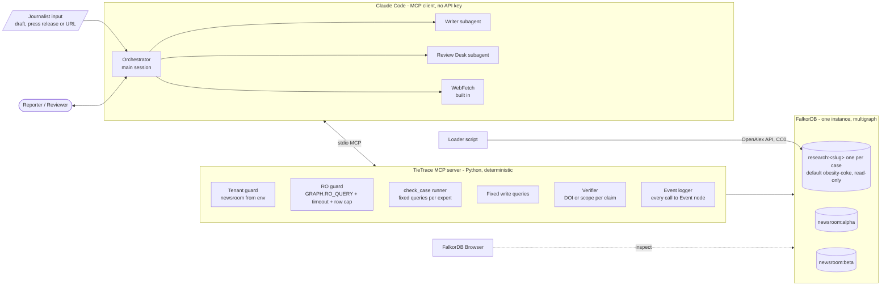
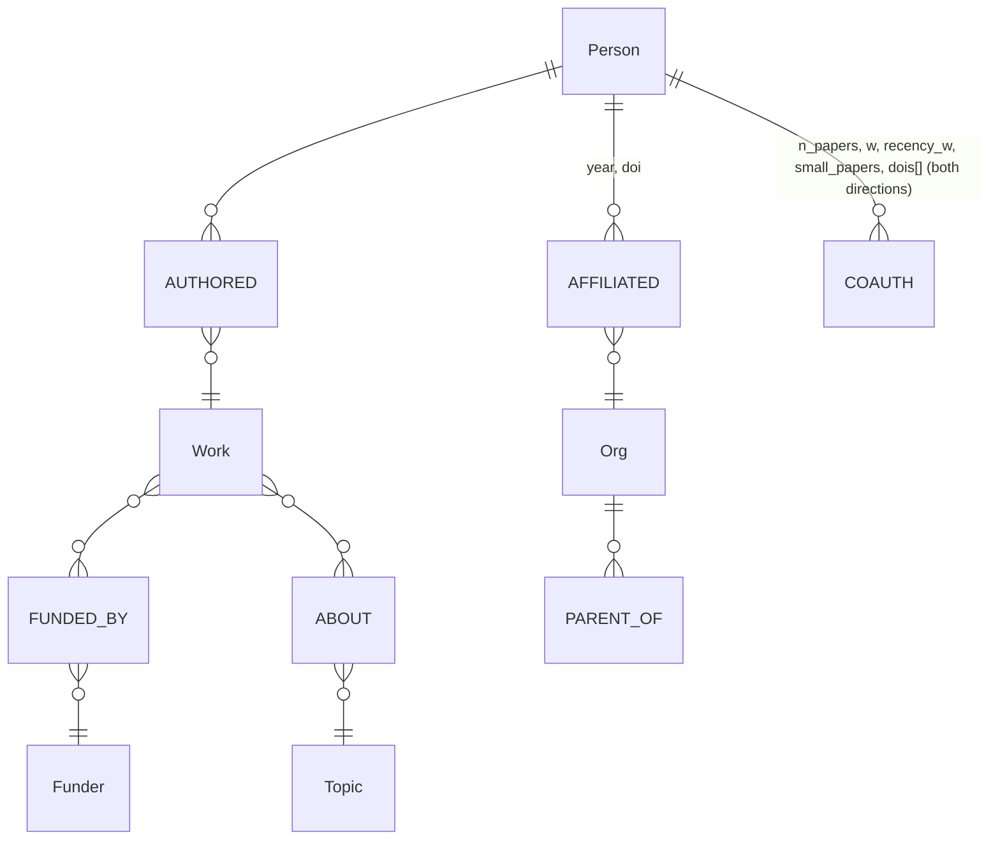
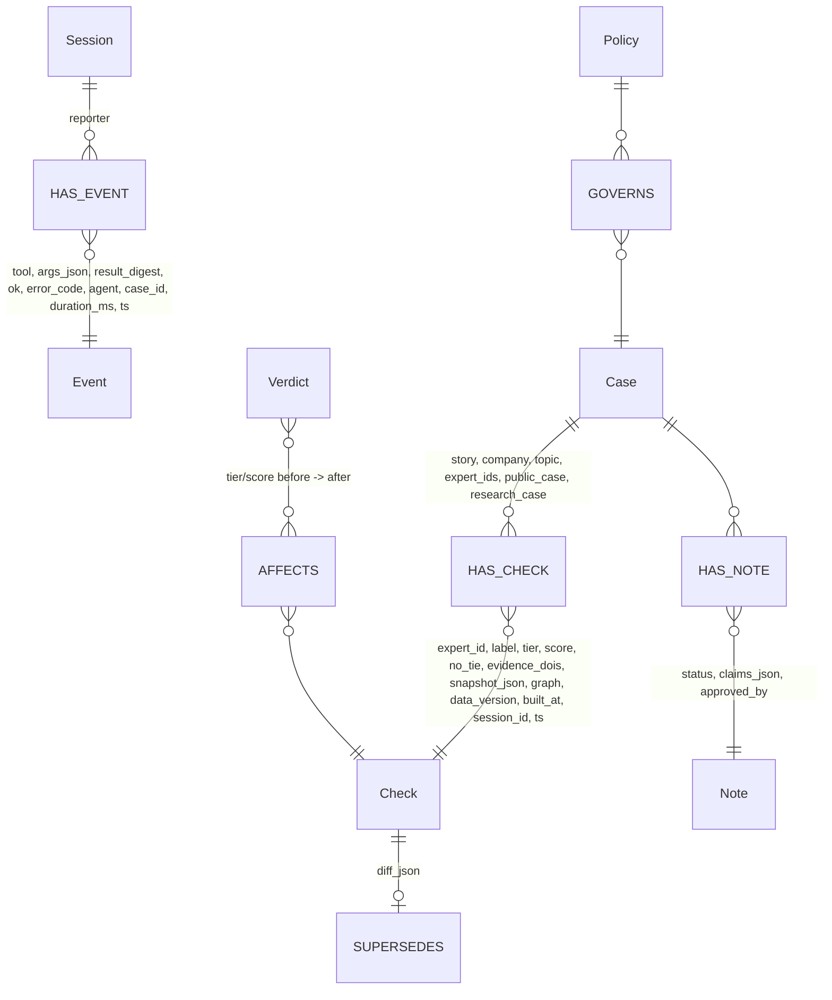
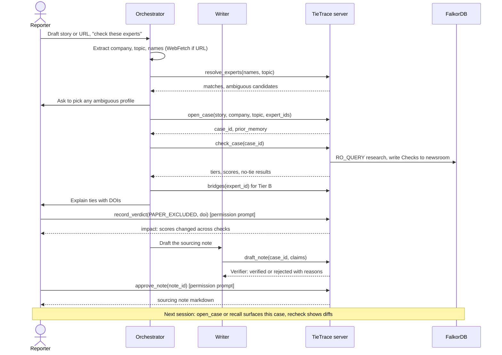
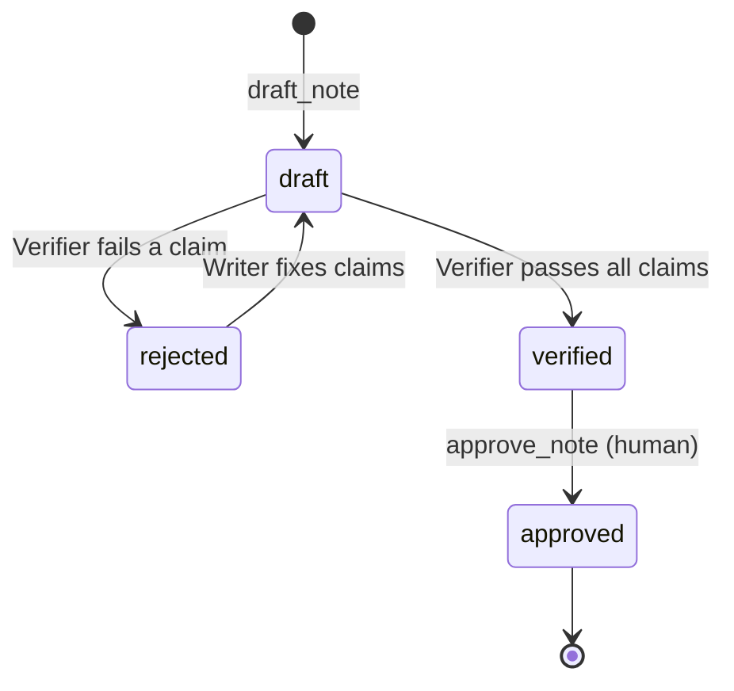

# TieTrace MCP spec (Tracks 1 & 2)

*Last updated by Aaryan, Oct 17 2026: phase-2 loose ends in 9f and 9e: a DOI's evidence items in a note's Sources line are split by " | " (DOIs still by "; "); `bridges` order is total and its Tier-A test is an indexed hash join. Before that, Oct 16: checkpoint 7 review round 3 in 9f (DOIs de-duplicated, reviewer string checked, typed text escaped, what the Verifier checks stated exactly). Before that, same day: checkpoint 7 review round 2 in 9f (the note prints server-written claim sentences; a no-tie text must be the fixed sentence; old notes refused; Greek nu). Before that, same day: checkpoint 7 review round 1 fixes in 9f (every case expert in the note, per-DOI source labels, story/company/topic checked before they enter the note, claim text must match its kind, normalised banned-word and name checks, BFS-unfiltered warning, heads read under the lock and a duplicate-proof Verdict write, approval refused after a rebuild, privacy note). Before that, same day: checkpoint 7 as built (section 9f): `record_verdict` (PAPER_EXCLUDED, PROFILE_MERGE, impact report, AFFECTS), verdicts applied by every tie-judging research tool and listed in `verdicts_applied`, `draft_note` with the Verifier enforced (new rules: Tier A DOIs only, server-supplied no-tie scope, no names, label check, "unbiased" and "clean source" banned), `approve_note` (idempotent re-approval), the Writer subagent, tier evidence kind in `prior_memory`/`recall`, score labels, verdict and note items in `recall`; `review_queue` and `set_policy` cut. Before that, same day: hardening round (section 9e): `check_case` no longer ranks by score, `tier_basis`/`score_basis` labels, `funder_coverage` and `expert_funder_coverage` in the no-tie scope (Verifier requires `funder_coverage`), `Event.duration_ms`, one BFS per tier-NONE check, UUIDv7 fallback for Python 3.13, `readOnlyHint` note. Before that, same day: checkpoint 6 round-2 polish in 9d (args_json wording, recheck NOT_FOUND when a chain's head is not found). Before that, same day: checkpoint 6 review fixes in 9d (tier NONE Checks always keep their no-tie scope, public case names only the checked expert, recheck never forks a chain, `recall` NOT_FOUND for unknown case/session, Events name a case only on success, args_json stays valid JSON, `cause` only when changed, privacy note). Before that, same day: checkpoint 6 memory graph (decided by Aaryan): `open_case`, `recall`, `recheck`, the Event log and the optional `agent` argument, `case_id` on `check_case` / `tie_report` / `check_no_tie` / `bridges`, staged load via the demo case `obesity-coke-staged` (`cache_from`, `loader.py --until-year`); details in section 9d. Before that, same day: round-3 polish (build recorded in status.json before the swap, atomic lock release, "build in progress" warning). Before that, same day: checkpoints 5c-5d review fixes (decided by Aaryan): `Work.junk` precomputed at load, build lock, stale-cache check, `list_cases` scope exception and staging warning, `TIETRACE_CASE` checked at start-up. Before that, same day: checkpoints 5c-5d: case config `cases/<slug>/case.json` and staging+RENAME build (section 3), `NO_GRAPH` error code and graph + `data_version` in every scope (section 4), optional `case` argument on every research tool and the new `list_cases` tool (section 5), details in section 9c; section 9b public ids now come from the case config.*
*Earlier: Abdul, Oct 16: section 9b checkpoint 5 notes (`server.py`: labels, `check_case` by `expert_ids`, `INTERNAL` code). Before that, Oct 16: section 9 note on the `eval/` scripts (no contract change). Before that, Oct 15: checkpoint 3 (review fixes applied, round 3: non-paper records flagged not dropped, bridges time budget; error codes, name lookup, junk rule, coverage wording), `research.py` and `verifier.py` written; section 9 lists where the code adds to or differs from this contract (decided by Abdul). Earlier: team attribution convention (see CLAUDE.md). Past content authored in Abdul's sessions.*

## Context
Graph Hacks (FalkorDB, Oct 15-18 2026). `tietrace-v2-redesign.md` fixes the data model, tiers and evaluation. This file defines every MCP tool (inputs, outputs, errors, which graph it touches, read or write) and diagrams the whole system, so the code can be written straight from it.

Hard rules:
- The server makes **no LLM calls**. Claude Code is the client; it reads the journalist's input and picks tools.
- Every read the model can trigger runs through `GRAPH.RO_QUERY`. Writes are fixed, parameterised queries.
- Every answer includes the Cypher it ran.
- Output never says "independent" or "conflicted".

### Who does what
| Part | Is | Job | Why here |
|---|---|---|---|
| **Orchestrator** | The main Claude Code session | Reads the journalist's input (pasted text, or a URL via Claude Code's built-in WebFetch), extracts company, topic and expert names, calls tools, explains results, asks the human for rulings | Needs judgment, so it needs an LLM. "Tool selection through MCP" is a Track 1 judging point |
| **Writer** | Claude Code subagent (`.claude/agents/writer.md`) | Drafts the sourcing note from saved Checks | Needs language. Its draft is checked by the Verifier |
| **Review Desk** | Claude Code subagent (stretch) | Reads `review_queue` and suggests which paper or profile to rule on first | Needs judgment |
| **Tie-checking** | Server tool `check_case` | Runs the fixed queries for every expert in a case | Deterministic: no LLM needed, so it does not get an agent |
| **Verifier** | Plain code in the server | Blocks claims without a DOI or scope | Must be deterministic |
| **Human** | Reporter or reviewer | Records verdicts, approves notes | The human makes the final call |

No crawler is built. Research data comes from the OpenAlex API. Journalist URLs are fetched with WebFetch; add the Firecrawl MCP server only if WebFetch fails on a page.

---

## 1. How it fits both tracks

| Track | What TieTrace shows | Tools |
|---|---|---|
| **1: Act on connected data** | The LLM picks graph tools. Multi-hop tie finding, `algo.BFS` for the no-tie proof, bridge paths with DOIs, max flow at depth 3 | `resolve_experts`, `find_experts`, `check_case`, `tie_report`, `check_no_tie`, `bridges` |
| **2: Memory and coordination** | **Episodic** memory: Session, Event and Check records. **Semantic**: Verdict facts. **Procedural**: a Policy node. **Shared state**: the orchestrator, the Writer and every reporter in a newsroom read and write the same newsroom graph. **Concurrency**: several reporter sessions at once. **Tenants**: one graph per newsroom | `open_case`, `recall`, `recheck`, `record_verdict`, `review_queue`, `draft_note`, `approve_note`, `set_policy` |

---

## 2. Architecture



Tenant rule: the server is started with `TIETRACE_NEWSROOM=alpha`. No tool takes a newsroom argument, so the model has no way to reach another tenant. The demo registers two servers (`claude mcp add tietrace-alpha ...` and `tietrace-beta`).

---

## 3. Graph schema

Research graph `research:<slug>`, one per case (as defined in redesign section 4). The slug matches `^[a-z0-9][a-z0-9-]{1,39}$`; the first case is `obesity-coke`.

**Case config and registry (checkpoint 5c).** Each case is a folder `cases/<slug>/`:
- `case.json` (in git, human-approved): `company`; `funders[] {id, name, kind: company|foundation}`; `institutions[] {id, name, rel: parent|subsidiary|bottler}` (exactly one `parent` if any); `topics[] {id, name}`; `years [first, last]`; `topic_cap`; `public_ids[]` (the only experts `check_case(public_case=true)` may name); `small_paper`; `recent_year`; `works_count_anomaly`; `max_api_calls`; `decided_by {decision: "Name, Mon D"}` for each of those ten decisions; optional `notes` and `rejected[] {id, name, reason}`. `loader.check_config` rejects unknown or missing keys, files of 20 KB or more, ID lists over 20 and malformed IDs.
- `raw/` (gitignored): the OpenAlex page cache. `obesity-coke` falls back to the checkpoint-2 cache `data/raw/`, so it rebuilds with zero API calls.
- `status.json` (gitignored, written by the loader): `status` (`building | ready | failed`), `updated_at`, and for the last good build `built_at`, `data_version`, `config_hash`, `counts`, `total_graph_sz_mb` (`GRAPH.MEMORY USAGE`), `graph`; `error` when failed.

**Build (loader, a human-run CLI, never a tool).** `loader.py --case <slug> --dry-run` writes nothing and prints expected works, API calls, cost and projected RAM from `per_page=1` count probes. `loader.py --case <slug> --rebuild` builds `staging:<slug>`, self-checks it (Person, Work, Topic, AUTHORED counts above 0; one `Meta` with `build_status = "complete"`, `data_version`, `recent_year`), then swaps it in with Redis `RENAME staging:<slug> research:<slug>`. If any step fails, the staging graph is dropped and the old `research:<slug>` is untouched. `Meta` also stores `slug` and `config_hash`.



Memory graph `newsroom:<id>`:



| Memory type | Node(s) | Written by | Read by |
|---|---|---|---|
| Episodic: what happened | `Session`, `Event`, `Check` | every tool call (logger), `check_case`, `tie_report` | `recall`, `open_case`, `recheck` |
| Semantic: facts learned | `Verdict` (`PAPER_EXCLUDED`, `PROFILE_MERGE`) | `record_verdict` | all scoring queries, passed in as exclusion params |
| Procedural: how this newsroom checks | `Policy` (single node) | `set_policy` (human) | every research tool, for its defaults |
| Shared state | `Case`, `Check`, `Note` | orchestrator, Writer, other reporters | everyone in the newsroom |

---

## 4. Shared conventions

**IDs.** `expert_id` is the OpenAlex author ID (`A5023888391`). Other IDs are server-generated time-ordered IDs with a prefix: `case_…`, `chk_…`, `vrd_…`, `note_…`, plus `ses_…` and `evt_…` (since checkpoint 6: a UUIDv7 in 32 hex characters, Python's stdlib equivalent of a ULID; decided by Aaryan, Oct 16. On Python 3.13, which has no `uuid.uuid7`, `memory.py` builds the same layout itself: 48-bit ms timestamp, version and variant bits, random bits).

**Anonymity.** Outputs give `label: "Expert #3"`, stable within a case. A `name` appears only when `case.public_case = true` (the documented GEBN case).

**Envelope.** Every tool returns:
```json
{
  "ok": true,
  "data": { },
  "cypher": [{"graph": "research:obesity-coke", "query": "MATCH …", "params": {}}],
  "scope": {"graph": "research:obesity-coke", "data_version": "openalex@2026-10-15", "hops": 3, "years": "2021-2026", "coverage": 0.966, "funder_coverage": 0.563, "expert_funder_coverage": 0.25, "load_scope": "…"},
  "verdicts_applied": ["vrd_…"],
  "warnings": ["profile_flag=no_orcid"]
}
```
On failure: `{"ok": false, "error": {"code": "...", "message": "..."}}`.
Error codes: `INVALID_ARG`, `NOT_FOUND`, `AMBIGUOUS`, `TIMEOUT`, `ROW_LIMIT`, `VERIFIER_REJECT`, `NOT_APPROVED`, `READ_ONLY`, `DB_ERROR` (any other database or connection error; added by Abdul, Oct 15), `INTERNAL` (an unexpected server bug; message has no traceback; added by Abdul, Oct 16), `NO_GRAPH` (the case has no `case.json`, or its graph `research:<slug>` does not exist; FalkorDB's "Invalid graph operation on empty key" maps to it; the message lists the known cases; added by Aaryan, Oct 16).

**Case.** Every research tool takes an optional `case: str` (a slug, never a graph name). A malformed slug gives `INVALID_ARG`; a slug with no `cases/<slug>/case.json` gives `NO_GRAPH`. Default: env `TIETRACE_CASE`, else `obesity-coke`. The newsroom still comes only from `TIETRACE_NEWSROOM`. Every `ok` envelope's `scope` names the `graph` and its `data_version` (except `list_cases`, see section 5). An invalid `TIETRACE_CASE` stops the server at start-up, like a missing `TIETRACE_NEWSROOM`.

**Defaults** come from `Policy`: `hops=3`, `years=5`, `author_cap=25`, `show_tier_c=true`, `row_limit=500`, `timeout_ms=3000`.

**Logging.** Every call writes one `Event` (tool name, args, a digest of the result, `agent`, `duration_ms`, timestamp) under the current `Session`. Each tool accepts an optional `agent` string (for example `"writer"`) for attribution.

---

## 5. Tools

### Track 1: research tools (read-only on `research:*`)

All tools below except `list_cases` also take the optional `case` slug (section 4).

**`list_cases`** (read-only, no arguments): which cases exist
- Out: `data.cases[]: {case, graph, registered, graph_exists, status, meta: {built_at, data_version, config_hash, counts, topic_ids, funder_ids, build_status} | null, total_graph_sz_mb}`, `data.default_case`. Built from `GRAPH.LIST` (only `research:*` names), each graph's `Meta` node and `cases/*/status.json`. Exception to the section-4 scope rule: it spans all graphs, so `scope` has `source` instead of `graph`/`data_version` (each case row has its own `meta.data_version`). `warnings` names each case with a `staging:` graph: "build in progress" while `build-lock:<slug>` exists, otherwise "an unfinished build left a staging graph" (still holding RAM).

**`resolve_experts`**: names from the journalist's input to OpenAlex IDs
- In: `names: str[]`, `topic: str`
- Out: `data.matches[]: {name_in_input, status: "MATCHED" | "AMBIGUOUS" | "NOT_FOUND", expert_id | null, candidates[]: {expert_id, works_on_topic, orcid, last_known_org}}`
- Ranks candidates by works on the topic. For `AMBIGUOUS`, the orchestrator asks the human to pick and never guesses.

**`find_experts`** (Q1): when the journalist names no one
- In: `topic: str` (OpenAlex topic ID or a text query), `n: int = 20` (max 100), `exclude_target_staff: bool = true`
- Out: `data.experts[]: {expert_id, label, works_on_topic, works_count, profile_flag}`, `data.topic: {id, name}`
- Cypher: full-text index on `Work.title`, then aggregate authors over `ABOUT`.

**`check_case`**: the deterministic batch run (writes Checks)
- In: `case_id` (since checkpoint 6; or `expert_ids`, see 9b and 9d)
- For each expert in the case it runs `tie_report`, plus `check_no_tie` when the tier is `NONE`, and saves a `Check`. Runs sequentially.
- Out: `data.results[]: {label, expert_id, tier, tier_basis, score, check_id, no_tie: "NO_TIE_FOUND" | "TIE_FOUND" | null}`, `data.counts: {A1, A2, B, C, NONE}`, `data.order`, `data.score_basis`. Order (since Oct 16, decided by Aaryan, because E1 and E2 failed): Tier A1, then A2, then every other checked expert (B, C and NONE together), then failed rows; input order inside each group. Never ranked by score.

**`tie_report`** (Q2): one expert in detail
- In: `expert_id: str`, `case_id: str | null`. If `case_id` is set, the result is also saved as a `Check`.
- Out:
```json
{"expert_id": "A…", "label": "Expert #3", "tier": "A1|A2|B|C|NONE", "tier_basis": "direct evidence", "score": 112.4,
 "score_basis": "context only — not validated (E1/E2); do not rank or compare experts by it",
 "evidence": [{"kind": "FUNDED_BY|AFFILIATED", "doi": "10.…", "year": 2014, "n_authors": 6,
               "via": "The Coca-Cola Company", "family_path": ["Coca-Cola Foundation", "The Coca-Cola Company"]}],
 "coauth_ties": [{"to_label": "Tier-A #2", "n_papers": 3, "w": 1.25, "dois": ["…"]}],
 "profile_flag": "ok", "wording": "OpenAlex records Expert #3 as author of a work funded by …",
 "check_id": "chk_…|null"}
```

**`check_no_tie`** (Q3, `algo.BFS`)
Renamed from `prove_independence` because the output must never use the word "independent".
- In: `expert_id`, `k: int = policy.hops` (1-3), `years: int = policy.years`
- Out: `data.result: "NO_TIE_FOUND" | "TIE_FOUND"`, `data.nearest: {tier_a_label, hops} | null`, `data.query_name: "q3_bfs_v1"`. The `scope` block is required here; the Verifier rejects the answer without it.
- Wording: "No Tier A or B tie and no Tier-A person within 3 co-author hops of Expert #1 (2021-2026). Funding records are thin: only 56% of topic works in the graph list any funder, and 3 of Expert #1's 12 loaded works (25%) list a funder (97% of topic works have funder or affiliation data, but affiliation says little about funding). Absence in the research record is not proof." The funder-only figures lead; all three numbers are always stated and come from the graph.

**`bridges`** (Q4)
- In: `expert_id`, `depth: 2 | 3 = 2`, `limit: int = 5`
- Out: `data.paths[]: {nodes: [label…], edges: [{dois[], w}], strength}`, `data.bridge_count`, and `data.max_flow: float | null` (depth 3 only; E4 decides whether this stays).

### Track 2: memory tools (`newsroom:<env>`)

**`open_case`**
- In: `story: str`, `company: str`, `topic: str`, `expert_ids: str[]`, `public_case: bool = false`, `case` (research case slug, section 4; see 9d)
- Writes: a `Case`, with experts stored in it.
- Out: `data.case_id`, `data.experts[]: {expert_id, label}`, and **`data.prior_memory[]`**: earlier Checks and Verdicts on these experts from other cases or other reporters ("Expert #3 was checked 2026-10-16 in case 'Sugar tax', tier B"). This is where cross-session recall shows up.

**`recall`**: episodic and semantic lookup
- In: one of `expert_id | case_id | session_id`, `limit: int = 20`
- Out: `data.timeline[]: {ts, kind: "check|verdict|event|note", summary, ref_id}`, ordered by time.

**`recheck`**
- In: `check_id`
- Out: `data.before: {tier, score, data_version}`, `data.after: {…}`, `data.diff: {new_evidence[], removed_evidence[], cause: "new_data|verdict|policy"}`. Writes a new `Check` linked by `SUPERSEDES`.

**`record_verdict`** (Q5): human-only. Claude Code's permission prompt is the gate; never allowlist this tool.
- In: `type: "PAPER_EXCLUDED" | "PROFILE_MERGE"`, `target: str` (a DOI, or an `[oa_id, oa_id]` pair), `reason: str`, `reviewer: str`, `case` (research case the target is checked in; since checkpoint 7, see 9f)
- Out: `data.verdict_id`, `data.impact: {experts_changed, checks_changed, details[]: {label, case_id, tier_before, tier_after, score_before, score_after}}`. Writes `AFFECTS` edges. (As built: 9f.)

**`review_queue`** (Review Desk; stretch; **cut**, not built, Aaryan, Oct 16)
- In: `limit: int = 3`
- Out: `data.items[]: {kind: "paper|profile_pair", target, would_change: int, cases: [case_id]}`

**`draft_note`** (Writer, then the Verifier runs automatically)
- In: `case_id`, `claims[]: {expert_id, text, evidence_refs: [doi | query_name]}`
- Verifier rules: a positive claim needs every DOI to exist as a stored edge on that expert. A "no tie" claim needs `query_name` plus `scope` with hops, years, coverage and `funder_coverage` (since Oct 16). The banned words "independent" and "conflicted" are rejected. (As built, with more rules: 9f.)
- Out: `data.note_id`, `data.status: "verified" | "rejected"`, `data.rejections[]: {claim_index, reason}`

**`approve_note`**: human-only (gated by the permission prompt)
- In: `note_id`, `reviewer`
- Out: `data.markdown` (the sourcing note and disclosure line). Fails with `NOT_APPROVED` if the note's status is not `verified`. Approving an approved note again is idempotent (9f).

**`set_policy`** (procedural memory; stretch; **cut**, not built, Aaryan, Oct 16): human-only
- In: any subset of `{hops, years, author_cap, show_tier_c}`
- Out: `data.policy`, and `data.affected_checks: int` (those checks are then flagged for `recheck`).

---

## 6. End-to-end flow



Note lifecycle:


---

## 7. New evaluation rows (added to redesign section 7)
- **E9 concurrency:** two reporter sessions on the same newsroom each run `check_case` on 10 experts and record verdicts at the same time. Pass: every Check and Verdict is stored, none are lost, and each impact report matches a fresh rerun.
- **E10 tenant isolation:** a server with `newsroom=alpha` cannot read beta's Checks through any tool. Pass: 0 rows.
- **E11 cross-session memory:** open a new Claude Code session and `open_case` on an overlapping expert. Pass: `prior_memory` is not empty.

## 8. Must-ship vs cut
- **Must ship:** `resolve_experts`, `find_experts`, `check_case`, `tie_report`, `check_no_tie`, `bridges`, `open_case`, `recall`, `recheck`, `record_verdict`, `draft_note`, `approve_note`, the envelope, the Event log, the Writer subagent.
- **Cut first:** `set_policy` (keep Policy as a seeded node), `review_queue` and the Review Desk, `max_flow` in `bridges`.
- **Status after checkpoint 7 (Aaryan, Oct 16):** built: `record_verdict`, `draft_note`, `approve_note`, the Writer subagent. Cut: `review_queue`, the Review Desk, `set_policy` and the `Policy` node.
- **Status after checkpoint 6 (Aaryan, Oct 16):** built: `open_case`, `recall`, `recheck`, the Event log, Check saving. Checkpoint 7: `record_verdict`, `draft_note`, `approve_note`, the Writer. Not built and not planned before submission unless time allows: `set_policy` and the `Policy` node (defaults stay the fixed `research.py` values), `review_queue`, `claim_task`/`handoff` (never in this spec).

---

## 9. Checkpoint 3 notes: where `research.py` and `verifier.py` add to this contract
*Last updated by Abdul, Oct 15 (decided by Abdul).* The tool names, envelope and error codes are unchanged. The functions take plain Python arguments; the MCP wrapper in `server.py` (checkpoint 5) maps tool arguments onto them.

- **Arguments not in section 5:** `tie_report`, `check_no_tie` and `bridges` also take `label` (the stable "Expert #n" from the case; default "Expert #1") and `public_case` (default false; true puts the name in the label). These are plain function arguments only: the checkpoint-5 MCP wrapper must derive them from the case (`open_case`, `public_case` flag) and must NOT expose them as tool arguments. Wrong types (a bool or string where an integer or list is required) return `INVALID_ARG`. `case_id` and the saved `Check` come with `check_case` in checkpoint 5/6, so `check_id` is `null` for now.
- **`ro_query` guard:** `GRAPH.RO_QUERY` with `timeout_ms=3000` and `row_cap=500`. More than `row_cap` rows, or reaching the server's own 10,000-row cut-off (which FalkorDB applies silently), raises `ROW_LIMIT`; a read with no `LIMIT` of its own gets `LIMIT row_cap+1`. Any other database error becomes `DB_ERROR` in the envelope. A write raises `READ_ONLY`. The two "who is Tier A" queries use `row_cap=10000` because they return about 2,600 rows; they are cached once per process (restart the server after a graph rebuild).
- **`find_experts`:** a topic ID (`T10010`) counts authors over `ABOUT`; any other text uses the full-text index on `Work.title` (all words must match), then counts authors over `ABOUT`. `exclude_target_staff` removes anyone with an affiliation to the company family.
- **`tie_report` extras:** each `evidence[]` item also has `work_id`, `tier` (A1 or A2), `reason` ("company-funded work", "foundation grant", "bottler affiliation", "large multi-author paper (n authors)") and `topic_label` ("on-topic" or "off-topic"). `family_path` is the funder name, or the org and its parent. `data` also has `score_parts {tier_weight, coauth_w, tier_a_links}`, `nearest {hops, anchor_count}` (tier C only) and `orcid`. `coauth_ties[]` also has `to_expert_id` and `anchor_tier`, lists Tier B links only (2+ recent papers with 25 or fewer authors; `dois` are only those papers), and the score counts every recent small-paper link to a Tier-A person.
- **Junk rule (one definition, `loader.is_junk_work`, reused by `research.py`):** F1000 peer-review reports (DOI prefix `10.5256/`) and works whose title starts with "Correction:", "Corrigendum", "Erratum", "Peer Review Report" or "Notice of Retraction" are not Tier A evidence and are skipped when `COAUTH`/`COAUTH_B` are built (a correction repeats the original's authors, so it looked like a second joint paper). Since Oct 16 (Aaryan) the rule is applied once at load time and stored as `Work.junk` (true for these reports, corrections, retraction notices and Index/Front Matter records); `research.NOT_JUNK` is `NOT w.junk`, so no query calls `toLower(title)` (FalkorDB 6.0.2 crashed there), and a graph whose `Meta` lacks `work_junk_flag` gives `DB_ERROR` "rebuild it". Records titled "Index" or "Front Matter" stay in the graph with `Work.non_paper = true`; they are neither Tier A evidence nor part of `COAUTH`/`COAUTH_B` (`Meta.non_paper_works`). Records with no title stay as ordinary works with `Work.title_unknown = true` (`Meta.title_unknown_works`); they count as evidence and their wording says "untitled work" (evidence items carry `untitled`).
- **Name lookup:** `Person.name_norm` (accents folded, lower case, indexed) is matched against the folded input. One exact name with works on the topic is `MATCHED`; several are `AMBIGUOUS`. If no exact name exists, people whose first and last word match as whole words are returned as `AMBIGUOUS` with a warning, never `MATCHED`. A single person with 0 works on the topic is `AMBIGUOUS` with a warning. Initials only match records written with the same initial.
- **Coverage and caveats:** the counts (topic works, with funder, with funder or affiliation, leftover duplicate groups by the loader's `norm_title`, links that rest on them) are computed in the loader and stored on the `Meta` node; `research.py` only reads them.
- **`check_no_tie`:** runs `algo.BFS` over `COAUTH_B` at depth 1, 2, 3 and stops at the first depth that reaches a Tier-A person (BFS gives no row when nothing is reached). `nearest.hops` is 0 when the expert has direct Tier A evidence. Also returns `tier_a_id`, `anchor_tier`, `label`, `wording`. `years` must be 5: the graph is precomputed for `Meta.recent_year` onward, and any other value returns `INVALID_ARG`. The `scope` block has `hops`, `years`, `coverage` (computed from the graph: topic works with funder or affiliation data), `coverage_funder_only`, `load_scope` and `caveats[]` (leftover possible duplicate records, author lists cut at 100, co-authors' other works not loaded).
- **`bridges`:** paths run over `COAUTH_B` (links with 2+ recent small papers). `strength` is the weakest link on the path. Paths are ordered by `strength` (highest first), then the Tier-A person's id, then the co-authors' ids, so the `LIMIT` always keeps the same paths. The Tier-A test is a second `MATCH (t:Person) WHERE t.oa_id IN $tier_a AND id(t) = id(a)` that FalkorDB runs as a Value Hash Join (a per-path `a.oa_id IN $tier_a` scanned the 3,000-id list once per path: 1.2 s instead of 0.2 s for the biggest hub). `bridge_count` is the number of paths. Each path also has `node_ids` and `anchor_tier`. `max_flow` is always `null` (cut). Time budget: the paths query gets 2 s and the path count 1 s; if only the count times out, `bridge_count` is `null` with a warning and the paths are still returned.
- **Loader change:** `COAUTH_B` also stores `recent_small_dois` and `recent_small_works` (only the papers that count toward Tier B), and `dedupe` prefers the record with a DOI when two records tie on scope.
- **Verifier** (`verifier.py`): `verify_claims(claims, {expert_id: [dois]})` returns `{"status", "rejections": [{claim_index, reason, code: "VERIFIER_REJECT"}]}`. A claim is `no_tie` when `kind == "no_tie"` or it carries `query_name` or `scope`; the only known `query_name` is `q3_bfs_v1`.
- **Evaluation scripts (checkpoint 4, no contract change):** `eval/*.py` call `research.ro_query` directly with a longer `timeout_ms` (120 s) and `row_cap=9000` for bulk reads, paged by year or id slices so no page reaches the server's 10,000-row cut-off, and reuse `research._tier_a` / `_staff` / `tie_report` / `resolve_experts` unchanged. `eval/e2.py` rebuilds Tier A per cut year from raw Work / FUNDED_BY / AFFILIATED data and checks that the all-years rebuild equals `research._tier_a`. (decided by Abdul)

---

## 9b. Checkpoint 5 notes: where `server.py` differs from sections 4-5
*Last updated by Abdul, Oct 16 (decided by Abdul).* `server.py` (stdio, `MCPServer` from the `mcp` 2.x SDK) exposes `resolve_experts`, `find_experts`, `tie_report`, `check_no_tie`, `bridges`, `check_case`. Every tool is read-only and returns the section-4 envelope (structured output). The memory tools come in checkpoints 6-7.

- **Newsroom:** `TIETRACE_NEWSROOM` (`[a-z0-9_-]+`) must be set or the server exits with a message. It is logged on stderr and held, but nothing is written to the newsroom graph yet (checkpoint 6).
- **Labels and `public_case` (deviation, until `open_case` exists):** no tool takes a name, a label string or `public_case`, except `check_case`.
  - `tie_report`, `check_no_tie`, `bridges` take `expert_number: int = 1` (1-99) and label the expert `Expert #<n>`. Co-authors stay `Co-author #i.j` / `Tier-A #i`. No name is ever shown by these three.
  - `check_case(expert_ids, public_case=false)` labels `Expert #1..#n` in input order. `public_case=true` puts the name of each listed expert in its label, but only when every id is in the case's `public_ids` list in `cases/<slug>/case.json` (for `obesity-coke`: Hill, Blair, Hand, Peters; until Oct 16 this was the hard-coded `GEBN_PUBLIC_IDS` set in `server.py`). Otherwise the flag is ignored, labels stay `Expert #n` and a warning says so, because a model-set flag has no human gate (decided by Abdul, Oct 16). Checkpoint 6 replaces this with `case.public_case`. It returns only label, id, tier, score and no-tie result, so no co-author names appear.
  - An extra argument such as `public_case` on a single-expert tool is ignored by the SDK. Checkpoint 6 replaces `expert_number` and `public_case` with the label and flag stored on the case.
- **`check_case(expert_ids)` instead of `case_id` (deviation):** `expert_ids: str[]` (1-25 distinct ids; `INVALID_ARG` otherwise). `case_id` support and saved Checks come with `open_case`; until then `check_id` is `null`. Experts run one after another; tier NONE also runs `check_no_tie`. After 90 s no new expert is started and the rest are listed in `data.not_checked` with a warning. Rows with the same tier and score keep the input order (superseded Oct 16, section 9e: Tier A first, then input order, never by score). Every row has an `error` key (null when fine). An unknown id gives a row with `tier: null` and an `error` object, ranked last, and the batch goes on; if every row fails with `DB_ERROR`, the whole answer is `ok: false`, `DB_ERROR`. `data.counts` is `{A1, A2, B, C, NONE}`. `cypher` has one entry per distinct query text: `params` of the first run, `runs` (how many times it ran) and `other_params` (the params of the other runs), which keeps 25 experts near 40 KB instead of 88 KB; `scope` is merged and `warnings` de-duplicated.
- **Not yet built (later checkpoints):** the `Policy` defaults (the code uses fixed `research.py` defaults). The optional `agent` argument, `case_id` and Event logging came in checkpoint 6 (section 9d).
- **Errors:** a bug inside a tool becomes `{"ok": false, "error": {"code": "INTERNAL"}}` without a traceback. An argument of the wrong JSON type (for example a number as `expert_id`) is rejected by the SDK before our code runs and comes back as an MCP tool error (`isError`) with a short validation message, not as an envelope.
- **Start-up:** the server loads Meta, the Tier-A map and the staff list once (about 0.6 s) so the first call is fast. If the database is down it still starts; tools then return `DB_ERROR`. Calls are serialised with a lock because `research.py` keeps one connection and one cache.

---

## 9c. Checkpoints 5c-5d notes: cases
*Last updated by Aaryan, Oct 16 2026 (decided by Aaryan).*

- **Graph selection:** `research.on_graph(graph)` sets the graph for the calls inside it (a contextvar; default `research.GRAPH` = `research:obesity-coke`). The server resolves `case` to `research:<slug>` once per call, under its lock. Cached facts (Meta, Tier-A map, staff) are keyed by `(graph, name)`, so one case never sees another case's Tier-A map; `research.clear_cache(graph=None)` clears one graph or all.
- **Second guard in `ro_query`:** the graph name must match `^research:[a-z0-9][a-z0-9-]{1,39}$` (the slug rule), otherwise `INVALID_ARG` before any query runs. `GRAPH.RO_QUERY` never creates a key, so a typo cannot create a graph; it gives `NO_GRAPH`.
- **Registry:** a case exists when `cases/<slug>/case.json` passes `loader.load_config`. `status.json` is informational (shown by `list_cases`); a failed rebuild leaves the previous graph usable.
- **`check_case`:** if every expert fails with the same `DB_ERROR` or `NO_GRAPH`, the whole answer is that error.
- **One build per case:** the loader takes the Redis key `build-lock:<slug>` (`SET NX EX` 4 h) and releases it at the end with an atomic compare-and-delete (a Lua `EVAL`, so it never deletes another build's lock); a second build of the same case exits with a message.
- **Rebuild while the server runs:** before each call the server reads `cases/<slug>/status.json` (a file, no query); if `built_at`, `config_hash` or `status` changed since it last looked, it clears that graph's cache. The loader writes the new `built_at`/`config_hash` (status still `building`) just before `RENAME` and `ready` just after, so a cache refilled from the old graph between the two writes is dropped again when `ready` appears; the only stale answers possible are calls in the milliseconds between `RENAME` and the `ready` write. If the build fails after that first write, status.json says `failed` but carries the new build's `built_at`. The loader also prints a notice after the swap.
- **Not built yet:** a `--build` flag (the loader keeps `--rebuild`), ACLs, the pre-flight RAM check against Docker's memory, and `--case` for the `eval/` scripts (E1-E8 stay obesity-coke only).

---

## 9d. Checkpoint 6 notes: the memory graph (`memory.py`, Track 2 tools)
*Last updated by Aaryan, Oct 16 2026 (decided by Aaryan).*

- **Tenant:** `TIETRACE_NEWSROOM` must match `^[a-z0-9][a-z0-9_-]{0,39}$` (tightened from `[a-z0-9_-]+`) or the server exits; it selects `newsroom:<id>` once at start-up (`memory.use_newsroom`). No tool takes a newsroom or a graph. Memory reads go through `GRAPH.RO_QUERY` (3 s timeout, 500-row cap, `ROW_LIMIT` above it); a newsroom with no graph yet reads as 0 rows. Writes are the fixed parameterised queries in `memory.py` (`LOG_EVENT_Q`, `OPEN_CASE_Q`, `SAVE_CHECK_Q`, `SAVE_RECHECK_Q`) and the index creation at start-up. A check, case or session id from another newsroom gives `NOT_FOUND`.
- **Event log:** every tool call (all ten tools, errors included) writes one `Event {id, tool, args_json (valid JSON; long values cut field by field, see below), result_digest (sha256 of the answer, 16 hex), ok, error_code, agent, case_id, duration_ms, ts}` under the process's `Session {id, started_at, pid}` (one per server process, created by `MERGE` on its first event). `case_id` is the call's `case_id` argument or the `data.case_id` of the answer, stored only when the call succeeded (so a mistyped or foreign case id leaves no trace). `args_json` stays valid JSON: strings over 300 characters and lists over 50 items are cut field by field, and if it is still over 4,000 characters only the argument names are kept. The Event write is not listed in the answer's `cypher` (it happens after the answer is built). If it fails, the answer gets the warning "this call was not saved to the memory log (...)" and is otherwise unchanged. Writes to one graph are serialised by FalkorDB, so two sessions cannot lose each other's events (E9 measures it).
- **Privacy (ethics note):** the memory graph stores what the journalist gave the tools: the story title in `Case.story` and in every Event's `args_json` (including the names sent to `resolve_experts`). It stays in the newsroom's own graph, is never shown by `recall` (event summaries never repeat arguments), and no other newsroom can read it.
- **`agent`:** every tool takes optional `agent` (1-30 characters `[a-z][a-z0-9_-]*`, for example `writer`); a bad value gives `INVALID_ARG`. It is stored on the Event only and never echoed.
- **`open_case`:** also takes `case` (the research case slug, default as in section 4); the newsroom `Case` stores it as `research_case`, and every later call with that `case_id` (`check_case`, `tie_report`, `check_no_tie`, `bridges`, `recheck`) runs on `research:<research_case>`. Passing a different `case` with a `case_id` gives `INVALID_ARG`. `story` is 1-2,000 characters, `company` and `topic` 1-200; `expert_ids` 1-25 distinct ids matching `A\d+`, labelled `Expert #i` by position. `public_case=true` is kept only when every id is in the research case's `public_ids` (otherwise false, with a warning), the same rule as `check_case`. Out: `data.case_id`, `research_case`, `public_case`, `experts[]: {expert_id, label}`, `prior_memory[]: {label, expert_id, check_id, case_id, tier, score, ts, data_version, graph, session_id, agent, summary}` (the summary says whether it was this session or which one, and the agent if given) = the latest (not superseded) Checks on these experts in any case of this newsroom, newest first, at most 100; the label is the expert's label in the NEW case. Prior verdicts join `prior_memory` with `record_verdict` (checkpoint 7). `scope` is `{graph: newsroom:<id>, research_case}` (memory tools carry no `data_version`, like `list_cases`).
- **Saved Checks:** `check_case(case_id)` saves one Check per expert that ran (rows with an error get none) and returns `check_id`; `tie_report(expert_id, case_id)` saves one (the expert must be in the case, else `INVALID_ARG`). A Check stores `expert_id, label, tier, score, no_tie, evidence_dois` (every DOI behind the tier: evidence plus Tier B links), `snapshot_json` (evidence items, Tier B links with DOIs, `score_parts`, `nearest`, `profile_flag`, and for tier NONE the `check_no_tie` result with `query_name`, hops, years, coverage, `funder_coverage`, `expert_funder_coverage`, for the Verifier; Checks saved before Oct 16 have no funder fields), `graph, data_version, built_at` (of the research graph), `session_id, agent, ts`. A tier NONE Check is saved only together with its `check_no_tie` result: `tie_report(case_id)` and `recheck` run `check_no_tie` for tier NONE, and if it fails no Check is saved (warning). A failed save is a warning ("check not saved ...") and `check_id` is null; the tie answer still stands. `check_case` takes exactly one of `case_id` or `expert_ids` (`expert_ids` keeps the checkpoint-5 behaviour and saves nothing). `check_no_tie` and `bridges` take `case_id` only for the label. In `check_case` and `recheck`, `check_no_tie` now uses the graph's own span (`Meta last_year - recent_year`) instead of a fixed 5, so a staged slice works.
- **`recall`:** exactly one of `expert_id` (that expert's Checks in every case), `case_id` (the case's Checks and the Events that name it) or `session_id` (the session's Checks and Events); `limit` 1-100. Out: `data.timeline[]: {ts, kind: "check" | "event", summary, ref_id, case_id (checks)}`, the newest `limit` items in time order, and `data.session_id` (the current session). Check summaries use the label stored on that Check (a name only if that case was public); event summaries say tool, agent and ok / error code, never the arguments. An unknown `case_id` or `session_id` (another newsroom's, or mistyped) gives `NOT_FOUND`; `recall(case_id)` leaves out earlier `recall` Events.
- **`recheck(check_id)`:** re-runs `tie_report` (and `check_no_tie` for tier NONE) for the Check's expert, with the Check's label, on its case's research graph as it is now. Out: `data.before {check_id, tier, score, nearest, data_version, built_at, ts, no_tie}`, `data.after {tier, score, nearest, data_version, built_at, no_tie}` (`nearest` explains a C or NONE change: hops and anchor count), `data.diff {new_evidence[], removed_evidence[], cause, rebuilt, changed, tier_changed, score_change}`, `data.check_id` (the new Check), `label`, `case_id`. Evidence items are compared by (kind, work, company entity); a Tier B link counts once per DOI (`{kind: "COAUTH_B", doi, to_expert_id}`). `rebuilt` is true when the research graph's `data_version` or `built_at` differs from the old Check's; `cause` is `"new_data"` only when the result `changed` AND the graph was rebuilt, else null (`verdict` and `policy` come with checkpoint 7 and `set_policy`). The new Check is linked `(new)-[:SUPERSEDES {diff_json}]->(old)` in the same write, which only succeeds while `old` is still the head of its chain, so a case has one current Check per expert. Rechecking a Check that was already superseded rechecks the chain's head instead (warning names both; if no head is found within 100 links, `NOT_FOUND` with the memory Cypher); if another recheck wins the race, nothing is written and `check_id` is that recheck's Check. The old Checks are kept. Warning also when the result changed without a rebuild. `scope` is the research scope plus `memory_graph`.
- **Names in a public case:** `public_case` names only the expert being checked (whose id is in `public_ids`); co-authors, Tier-A people, bridge nodes and `nearest` are always `Co-author #i.j` / `Tier-A #i` (`research._label` is called with `public_case=False` for them).
- **Tool hints:** `tie_report`, `check_case`, `open_case` and `recheck` have `readOnlyHint=false` (they add memory records; `destructiveHint=false`, nothing is ever deleted and the research graph is never written). The others stay read-only (their Event write is logging). Why (decided by Aaryan, Oct 16): MCP's `readOnlyHint` means the tool does not modify its environment, i.e. nothing the user or model acts on; the Event is an append-only audit record (seen only through `recall`) that never changes a research result, Case or Check, so it is a side effect like a server log, and marking every tool as writing would hide the real difference between a lookup and a tool that saves a Case or Check.
- **Staged load (the `recheck` demo; decided by Aaryan, Oct 16):** OpenAlex data is static, so the demo uses a separate case `obesity-coke-staged`: an exact copy of `obesity-coke`'s `case.json` plus `cache_from: "obesity-coke"` (new optional key: read that case's raw cache; such a case never calls the API, refuses `--refresh` and stops before writing on any cache miss, so it can never overwrite the other case's cache) and `max_api_calls: 1`. `loader.py --until-year Y` keeps only works published up to Y (works with no year are kept), trims `Meta.years`, tags `data_version` `openalex@<date>+untilY`, adds `until_year` and a "STAGED DEMO SLICE" note to `load_scope`; it is refused unless the case has `cache_from` (so `research:obesity-coke` and `research:philip-morris-lung` can never be cut) and Y is from `recent_year` to last year - 1. Steps: (1) `uv run python loader.py --case obesity-coke-staged --until-year 2023` (from cache, 0 API calls, about 1 min, 587 MB); (2) `open_case(..., case="obesity-coke-staged")` and `check_case(case_id)` save Checks; (3) `uv run python loader.py --case obesity-coke-staged --rebuild` loads all years (staging + RENAME, about 1 min, 780 MB; needs both graphs in RAM for a moment); (4) `recheck(check_id)` shows the new evidence with `cause: "new_data"`. Delete the graph afterwards (`GRAPH.DELETE research:obesity-coke-staged`) to free the RAM.
- **Not built:** `Policy`, verdicts in `prior_memory` / `recall` (checkpoint 7), `note` items in `recall` (checkpoint 7), a per-reporter identity (a Session is one server process; Claude Code's subagents share it, which is what `agent` is for).

## 9e. Hardening round (Aaryan, Oct 16): where the code changed after an external review

- **Tier B/C and the score are context only** (decided by Aaryan, Oct 16, because E1 and E2 failed; `eval/results.md`). `tie_report` adds `data.tier_basis`: `"direct evidence"` for A1/A2, `"network context only — not validated (E1/E2)"` for B/C, and for NONE "no tie found in the research record (see check_no_tie for the scope)"; and `data.score_basis` ("context only — not validated (E1/E2); do not rank or compare experts by it"). The B and C sentences in `wording` say "network context only, not validated". The score formula is unchanged (redesign section 4).
- **`check_case` order (contract change):** Tier A1, then A2, then every other checked expert (B, C and NONE together), then rows with an error; Python's stable sort keeps the input order inside each group. It no longer sorts by score or puts B before C before NONE. Each row has `tier_basis`; `data.order` states the rule and `data.score_basis` the score label. `data.counts` is unchanged. `find_experts` is unchanged.
- **Funder-only coverage in every no-tie scope:** `check_no_tie`'s `scope` adds `funder_coverage` (topic works with any `FUNDED_BY` / topic works, from the `Meta` counts; the same number as the older `coverage_funder_only`, kept for old callers), `expert_funder_coverage` (the expert's loaded non-junk works with any `FUNDED_BY` edge / the expert's loaded non-junk works; one indexed read per call; `null` if the expert has no such work) and `expert_works`. `coverage` stays with its old meaning, funder OR affiliation data (about 0.966 for obesity-coke, E7), which overstates how much funding is recorded. The NO_TIE_FOUND wording leads with the funder-only figures. `tie_report`'s scope also gets `funder_coverage`. The saved NONE snapshot keeps `funder_coverage` and `expert_funder_coverage`. The Verifier requires `funder_coverage` in a no-tie claim's scope.
- **One BFS per tier-NONE check:** a tier NONE `tie_report` has already run the depth 1-3 BFS and reached no Tier-A person, so `check_case`, `tie_report(case_id)` and `recheck` call `research.check_no_tie(..., searched_hops=3)`, which skips the repeat. The answer is unchanged (a test compares it with a fresh `check_no_tie`); the combined `cypher` lists the BFS once. `searched_hops` is a plain function argument, never a tool argument.
- **`Event.duration_ms`:** the tool's wall time in ms (float, one decimal), measured in `server.py` around the whole call (argument check plus tool), not counting the Event write itself. It includes the time spent waiting for the server's lock (research calls run one at a time), so under parallel calls it measures queueing plus work.
- **Two funder shares count junk differently:** `funder_coverage` comes from the `Meta` counts, which count every topic work (junk records such as corrections included); `expert_funder_coverage` leaves the expert's junk records out (`NOT w.junk`). The difference is small (junk records are a few percent) but the two numbers are not computed the same way.
- **`searched_hops`** is only ever 3, and only right after a tier NONE `tie_report` (its depth 1-3 BFS reached no Tier-A person); both callers in `server.py` say so in a comment.
- **Python 3.13:** see section 4 (IDs). No other 3.14-only API is used.

## 9f. Checkpoint 7 (Aaryan, Oct 16): verdicts, sourcing notes, the Writer, as built
*Last updated by Aaryan, Oct 16 2026 (decided by Aaryan unless noted).* Files: `server.py` (three tools), `memory.py` (Verdict and Note storage, summaries), `research.py` (verdicts applied to the queries), `verifier.py` (new rules), `.claude/agents/writer.md`, `tests/test_notes.py`.

- **Memory schema added:** `Verdict {id, type, target ("10.x/..." or "A1,A2" sorted), doi, ids, reason, reviewer, expert_ids (merge pair plus experts whose checks changed), checks_changed, research_case, session_id, agent, ts}`; `(Verdict)-[:AFFECTS {tier_before, tier_after, score_before, score_after, new_check_id}]->(Check)`; `(Case)-[:HAS_NOTE]->(Note {id, case_id, status: verified|rejected|approved, claims_json, rejections_json, verdicts, graph, data_version, session_id, agent, ts, approved_by, approved_at})`. `Check` also stores `verdicts` (the ids in force when it was computed; Checks from before checkpoint 7 read as `[]`), and its snapshot keeps each evidence item's `reason`. Indexes on `Verdict.id` and `Note.id`. All writes are fixed queries in `memory.py` (`SAVE_VERDICT_Q`, `AFFECTS_Q`, `SAVE_NOTE_Q`, `APPROVE_NOTE_Q`). There is no tool to undo a verdict (a human would delete the node by hand); a second identical verdict gives `INVALID_ARG`.
- **Verdicts in the research tools:** `tie_report`, `check_no_tie`, `bridges`, `check_case`, `recheck`, `draft_note` and `record_verdict` read every `Verdict` of the newsroom (one `GRAPH.RO_QUERY`) and run inside `research.with_verdicts(...)`. Their envelope's `verdicts_applied` lists those verdict ids (every verdict of the newsroom, since each one is a filter on every query). The verdict read is listed first in `cypher` only when it found verdicts, so with none in force a research answer is exactly as before (like the Event write, a read that changes nothing is not listed). `resolve_experts`, `find_experts` and `list_cases` do not apply verdicts and return `verdicts_applied: []`. The research graph is never written: excluded works are a query parameter.
- **What `PAPER_EXCLUDED` recomputes:** the DOI is looked up in the current graph (`w.doi IN $dois`, indexed) and those work ids become `$x_works`. Recomputed exactly: Tier A evidence (the funded and affiliation queries skip the work); the Tier-A set (`_tier_a` is cached per set of excluded works), so co-authors who were Tier A only through that paper stop counting; Tier B links and the score (for each co-author link whose `COAUTH.works` holds the paper, if the paper is recent and small its share `1/(n_authors-1)` and one paper are taken off, exactly as `loader.coauth_rows` added them; a Tier B link needs 2 papers left); `expert_funder_coverage`; `bridges` paths (a link left with fewer than 2 papers drops the path, link weights and strength are recomputed). **Not recomputed:** `algo.BFS` takes no edge filter, so a `COAUTH_B` edge that exists only because of the excluded paper is still walked for Tier C and `check_no_tie` (only who counts as Tier A changes there); `bridges` keeps its `LIMIT` and order from before the filter and `bridge_count` is not adjusted (a warning says how many paths were left out); the graph-wide `coverage`/`funder_coverage` figures; `find_experts`'s staff list. `data.impact.recomputed` says this in one sentence.
- **What `PROFILE_MERGE` does:** for either id (and chains of merges), `tie_report` and `check_no_tie` use the evidence of every merged profile (`p.oa_id IN $ids`), co-author links of all of them added per co-author (links between the merged ids are left out; Tier B DOIs are their union), BFS from each of them, and both get the best Tier A of the group. Limits: `bridges` still starts from the one id asked; if both profiles were on the same paper with the same co-author, that link's score share is counted twice; two single-paper links do not become a Tier B link (no `COAUTH_B` edge exists to carry the DOIs). `tie_report` warns that profiles were combined.
- **`record_verdict`:** human-only, `destructiveHint=true` (it supersedes saved Checks and changes every later answer), title "Human only: ...", description starts "HUMAN ONLY". Checks: type; target a DOI matching `10.\d{4,9}/...` after `verifier.norm_doi` (URL forms accepted) or two distinct ids matching `A\d+`; `reason` 1-1,000 and `reviewer` 1-100 characters; `case` (default the server's case) must have a graph (`NO_GRAPH`), and the DOI must be a Work there / both ids Persons there (`NOT_FOUND`). Then every current Check of the newsroom (heads of their `SUPERSEDES` chains, any research case; more than 500 gives `ROW_LIMIT` and nothing is written) is run again with the old verdicts plus the new one, on its own research graph, within the 90 s batch budget (the rest are listed in `impact.not_rechecked` and keep their old result until `recheck`). Only after all reads: the `Verdict` is written; each changed Check gets a new Check that `SUPERSEDES` it (`diff.cause = "verdict"`, or `"new_data"` if the research graph was rebuilt since, with a warning) and an `AFFECTS` edge to the old Check. Out: `data.verdict_id, type, target, impact {experts_changed, checks_changed, checks_rechecked, not_rechecked[], details[] {label, expert_id, case_id, check_id, new_check_id, tier_before, tier_after, score_before, score_after, rebuilt}, score_basis, recomputed}`; `scope {graph: newsroom, research_case}`; `verdicts_applied` = all ids including the new one. The whole call holds the server lock.
- **`recheck` cause:** `"new_data"` when the result changed and the graph was rebuilt; else `"verdict"` when it changed and the verdict ids differ from the old Check's; else null (with the old "server code change?" warning only in that last case). `before`/`after` carry `verdicts`; `diff.score_basis` labels the score change "context only".
- **`draft_note(case_id, claims[])`:** claims are 1-50 `{expert_id (one of the case's), text (1-1,000), evidence_refs (0-20 strings)}` and nothing else (`INVALID_ARG`). The server runs `tie_report` (plus `check_no_tie` for tier NONE) once per expert on the case's research graph with the verdicts, then builds each Verifier claim itself: a claim whose refs include `q3_bfs_v1` is a no-tie claim and gets `query_name`, the fresh scope (hops, years, coverage, funder_coverage, expert_funder_coverage, expert_works) and the result from that run (the Writer cannot supply a scope); otherwise it is a tie claim, and its DOIs must be in the expert's **Tier A evidence** (`data.evidence[].doi`, verdicts applied). Tier B co-author DOIs are not accepted (B/C are context only, section 9e). New Verifier rules: "unbiased" and "clean source(s)" are banned (decided by Aaryan after the 5f run); a no-tie claim is rejected unless the result is NO_TIE_FOUND; a no-tie claim may cite only its query name; in a case that is not public the text must not contain any case expert's full name or surname (3+ letters, accent-folded, whole word; this can reject an ordinary word that equals a surname, such as "hand": rephrase); the text must not mention an `Expert #k` other than the claim's own label. Rejection reasons never repeat a name. A Note is stored either way (`verified` or `rejected`) with the claims as checked, each with its tier and the expert's disclosure line, and the verdict ids in force. Out: `data.note_id, case_id, status, claims_checked, rejections[] {claim_index, reason, code: VERIFIER_REJECT}`; a rejected draft is `ok: true` with a warning (the note exists; the Writer fixes the claims and calls again, which makes a new Note).
- **`approve_note(note_id, reviewer)`:** human-only (title "Human only: ...", `destructiveHint=false`, `idempotentHint=true`). `NOT_APPROVED` if the note is `rejected`, or if the newsroom's verdicts differ from those the note was drafted with (draft again). Otherwise `SET status = 'approved', approved_by, approved_at` (only while still `verified`, so two approvals write once). Re-approval of an approved note is idempotent: same markdown, the first reviewer kept, a warning, nothing written. `data.markdown`: title (the story), company, topic, research graph and data_version, reviewer and time, note and case ids, verdicts applied; one section per expert (by label) with a disclosure line ("ties found in the research record for Expert #n: tier A2 via Coca-Cola Foundation funding (FUNDED_BY), 7 work(s): foundation grant (direct evidence)" or "no tie found in the research record ... within the stated scope; absence is not proof"); each tie claim with its DOIs as `https://doi.org/<doi>` links (percent-encoded); each no-tie claim with query name, hops, years, funder share of topic works, the expert's share and the funder-or-affiliation share. Not re-checked at approval: a research graph rebuilt after the draft (open risk).
- **Writer subagent** (`.claude/agents/writer.md`, Claude Code frontmatter `name`, `description`, `tools`, `model`): tools limited to `recall`, `tie_report`, `check_no_tie`, `draft_note` of the server registered as `tietrace-alpha` (copy and rename the prefix for another newsroom). It reads the case with `recall(case_id)` (check items now carry `expert_id`, `label`, `tier`), gets DOIs from `tie_report` without `case_id` (so it saves no Check), writes claims only from tool output, calls `draft_note` and fixes rejected claims (at most three tries); it never calls `record_verdict` or `approve_note`. No settings file in this repo allowlists any human-only tool (`tests/test_notes.py` checks `.claude/settings*.json` and the user's `~/.claude/settings.json`).
- **Tier meaning in memory (E11 follow-up):** `prior_memory` check items get `kind: "check"`, `tier_basis` (for example "A2 via Coca-Cola Foundation funding (FUNDED_BY), 7 work(s): foundation grant (direct evidence)", built from the Check's snapshot; B, C and NONE say network context only or the no-tie scope) and `score_basis`; the summary uses `tier_basis`. Verdicts that name the experts join `prior_memory` as `kind: "verdict"` items. `recall` check summaries use the same tier text and "score x (context only, not validated)"; `recall` adds `kind: "verdict"` items (by expert: verdicts whose `expert_ids` hold it; by case: verdicts with an AFFECTS edge to the case's checks; by session) and `kind: "note"` items (by case and session). Summaries never repeat a verdict's reason (it may hold a name). The Obsidian export labels scores "(context only)" and no longer prints "(this expert: None)".
- **Wording (hardening should-fixes):** a no-tie for an expert with only junk records says "has no loaded paper (junk records such as corrections are left out)"; "Funding records are thin: only" is said only when `funder_coverage` < 0.6 (`research.THIN_FUNDER`; both current graphs are below it: 0.563 and 0.375), otherwise the share is stated plainly.
- **Cut:** `review_queue`, the Review Desk subagent and `set_policy` (cut list order; no time left in checkpoint 7).
- **Review round 1 fixes (Aaryan, Oct 16; these replace the matching statements above where they differ):**
  - *Every case expert is in the note.* `draft_note` runs `tie_report` (plus `check_no_tie` for NONE) for **every** expert of the case, not only those with claims, and stores `experts_json` (label and disclosure line for each). The approved markdown has a section per case expert in case order: A1/A2 "ties found in the research record: tier ... (direct evidence)", B/C "tier ...: network context only, not validated; no claim is made about it", NONE "no tie found in the research record within the stated scope (q3_bfs_v1, hops, years, funder share); absence is not proof", or the failure ("could not be checked (CODE)" / "check_no_tie failed (CODE)"). An expert without a claim says "No claim in this note."
  - *Sources say what each DOI is.* Each tie claim stores `sources[] {doi, evidence[] {kind, via, tier, topic_label, year}}` from the draft-time evidence; the markdown prints them after each link ("FUNDED_BY Coca-Cola Foundation, tier A2, off-topic, 2020"). A DOI with several evidence items prints each as its own group, split by " | ", inside that DOI's brackets; different DOIs are split by "; " ("[10.1155/2016/8236439](...) (FUNDED_BY Coca-Cola, tier A1, on-topic, 2016 | FUNDED_BY Coca-Cola Foundation, tier A2, on-topic, 2016)"). (Changed Oct 17 by Aaryan; before, the items were comma-joined and two tiers ran together.)
  - *Story, company and topic.* Checked at draft time with the same banned-word and name check as the claims; a field that fails is left out of the note (`header_json` stores it as null and the markdown says it was left out).
  - *Claim text must match its kind* (draft_note claims only): a no-tie text must contain "no tie found" and none of funded, paid, payment(s), affiliated, employed, employee, employs, sponsored, received, receives, consultant, consulted, consults, grantee; a tie text must not contain "no tie(s)".
  - *Word checks* run on a normalised text (`verifier.norm_text`: NFKC, format characters such as zero-width spaces removed, Cyrillic/Greek look-alike letters mapped to Latin, accents dropped, lower case). Banned: independent(s), conflicted, unbiased, unbiassed, impartial, `clean[\s-]+source(s)`; "avoid": independence, independently, unconflicted.
  - *Name check* forms per name: full name, first + surname, initial + surname (so 2-letter surnames are caught next to a first name or initial), and the surname alone if 3+ letters; matched as whole words on the letters-only text and on the same text with runs of single letters joined ("H I L L"). The label check also reads "Expert 2" and "Expert no. 2".
  - *Failed check_no_tie:* the rejection says "check_no_tie failed (CODE)", not "found a tie".
  - *BFS and verdicts:* while a PAPER_EXCLUDED paper is in the graph, a Tier C `tie_report` and a `check_no_tie` TIE_FOUND at 1+ hops carry the warning that `algo.BFS` is not filtered by verdicts (`research.BFS_UNFILTERED`); NO_TIE_FOUND needs no warning (excluding a paper only removes ties).
  - *record_verdict concurrency:* the duplicate check and the read of current Checks happen inside the server lock (`_lock` is now an `RLock`, so one thread may nest calls). `SAVE_VERDICT_Q` itself refuses a duplicate (`OPTIONAL MATCH ... WITH count(d) AS n WHERE n = 0 CREATE ...`; FalkorDB serialises writes to one graph, so this holds across processes; note `WITH d WHERE d IS NULL` after an OPTIONAL MATCH did **not** filter in FalkorDB 4.22.1, so the count form is used). If a changed Check was superseded meanwhile, the new Check supersedes the newest one in its chain and AFFECTS points at that one.
  - *approve_note* also refuses (`NOT_APPROVED`) when the research graph's `data_version` or `built_at` differs from the draft's (Note stores `built_at`).
  - *Privacy (ethics note, adds to 9d):* every Event's `args_json` stores the call's arguments, so the claim texts of every `draft_note` (rejected ones included) and every verdict's `reason` are kept in the newsroom graph, as is `Verdict.reason`. They are never shown by `recall` or `prior_memory`, and no other newsroom can read them, but a claim text the Verifier rejected for naming an expert is still stored there.
- **Review round 2 (Aaryan, Oct 16; replaces the "claim text must match its kind" rule above):**
  - *The note never prints the Writer's text.* For every claim the server stores and prints its own sentence (`server._claim_sentence`): a tie claim "Ties found in the research record: OpenAlex records Expert #n as author of k cited work(s): funded by <funder>; listing an affiliation with <org>." (from the cited DOIs' stored evidence), a no-tie claim "No tie found in the research record for Expert #n within the stated scope; absence is not proof." Each stored claim has `writer_text_replaced`. The Writer chooses which claims and DOIs go in (decided by Aaryan: smaller and safer than more word lists, which kept missing phrasings such as "works for", "a grant", "financed", "not connected").
  - *The Writer's text is still checked* (banned words, names, labels, kind): a no-tie text must match only the fixed sentence (`verifier.NO_TIE_TEMPLATE`, case, spacing and accents ignored; the "for Expert #n", "within the stated scope" and "absence is not proof" parts may be left out), and a tie text must not say "no tie(s)". A tie text that denies the tie in other words can still verify, but it is never printed.
  - *Notes drafted before round 1* (no `header_json` / `experts_json`) give `NOT_APPROVED` ("run draft_note again") instead of a crash.
  - Greek ν maps to "v"; the separate NFKC step was dropped (fold's NFKD already turns full-width letters into plain ones). `record_verdict` keeps its duplicate read first under the lock (a comment says why: one read instead of re-running every check; the write refuses a duplicate again).
- **Review round 3 (Aaryan, Oct 16):**
  - *What the Verifier checks, exactly.* Tie claim: every cited DOI is Tier A evidence of that expert (verdicts applied), the text has no banned word, no case expert's name (non-public case), no other expert's label and no "no tie(s)". It does **not** check what the text means; that is why the printed sentence is always the server's (`_claim_sentence`), built from the cited DOIs' stored evidence. No-tie claim: `q3_bfs_v1` is its only ref, the fresh `check_no_tie` result is NO_TIE_FOUND with the full scope (server-supplied), and the text matches `NO_TIE_TEMPLATE`: "No tie found in the research record" optionally followed by "for Expert #n", "within the stated scope" and "; absence is not proof" (the short form is accepted because the Reviewer's round-2 test requires "No tie found in the research record for Expert #2." to verify; the printed sentence is always the full one with the scope).
  - *DOIs are de-duplicated* after `norm_doi`, so one DOI cited as bare, upper-case and `https://doi.org/` form counts as one work.
  - *The reviewer string* is printed in the note, so `approve_note` runs the banned-word and name check on it (case experts' names unless the case is public) and gives `INVALID_ARG` if it fails; nothing is written.
  - *Typed text is escaped* (`memory.md_safe`): the story, company, topic and reviewer are put on one line, `& < >` become HTML entities and Markdown control characters (backslash, backtick, `* _ [ ] { } ( ) # | ! ~`) are backslash-escaped, so a story title cannot inject a link, heading or HTML into the note.
