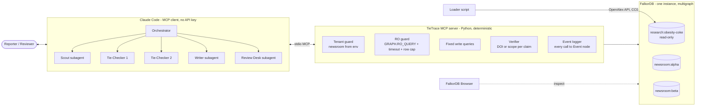
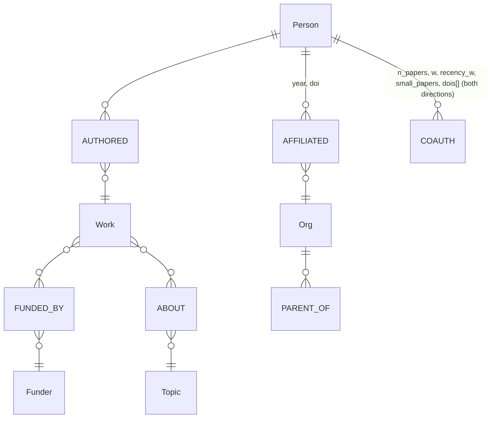
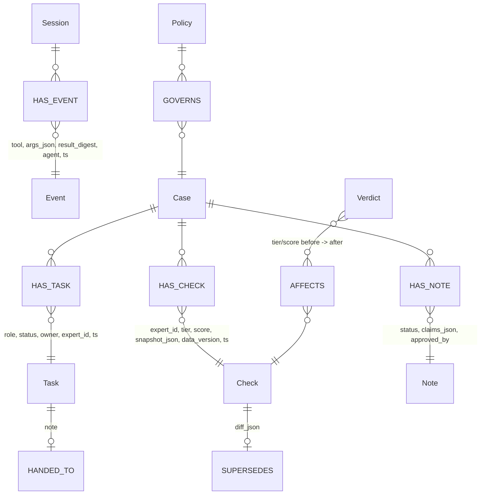
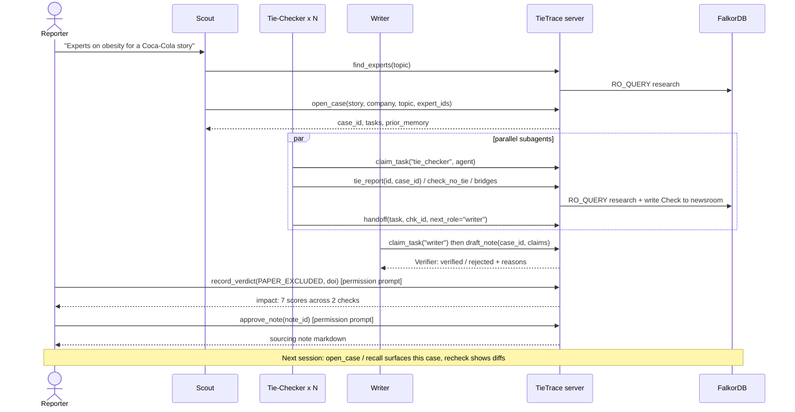
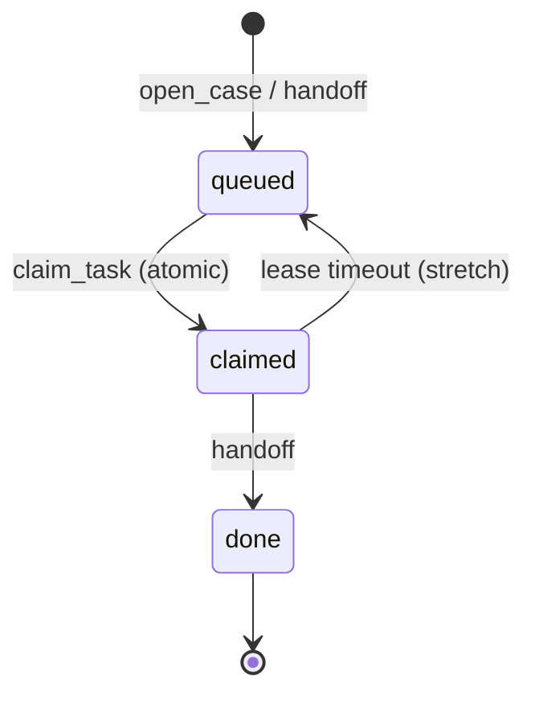

# TieTrace MCP spec (Tracks 1 & 2)

## Context
Graph Hacks (FalkorDB, Oct 15-18 2026). `tietrace-v2-redesign.md` already fixes the data model, tiers and evaluation, but the MCP layer is only a 6-row table, and section 15 admits **Track 2 is thin** (it's just `recheck` plus verdict impact). The Track 2 brief asks for episodic, semantic and procedural memory, persistent history, shared state and handoffs between agents, high-concurrency reads and writes, and separate memory per tenant.
Goal: one document that defines every MCP tool (inputs, outputs, errors, which graph it touches, read or write) plus Mermaid diagrams of the whole model, so the code can be written straight from it.


Constraints carried over: the server makes no LLM calls; Claude Code is the client and its subagents are the agents (memory: tietrace-llm-choice). Every read the model can trigger runs through `GRAPH.RO_QUERY`. Writes are fixed, parameterised queries. Every answer includes the Cypher it ran. Output never says "independent" or "conflicted".

---

## 1. How it fits both tracks

| Track | What TieTrace shows | Tools |
|---|---|---|
| **1: Act on connected data** | Multi-hop tie finding, `algo.BFS` for the no-tie proof, bridge paths with DOIs, max flow at depth 3, all as tools the agent picks itself | `find_experts`, `tie_report`, `check_no_tie`, `bridges` |
| **2: Memory and coordination** | **Episodic** memory: Session, Event and Check records. **Semantic**: Verdict facts. **Procedural**: a Policy node. Shared Task queue with atomic claims and handoffs between Claude Code subagents. One graph per newsroom | `open_case`, `recall`, `recheck`, `record_verdict`, `review_queue`, `claim_task`, `handoff`, `draft_note`, `approve_note`, `set_policy` |

Agents are Claude Code subagents (`.claude/agents/*.md`, to be written later): **Scout**, **Tie-Checker** (runs as N copies in parallel), **Writer**, **Review Desk**. The **Verifier** is plain code inside the server, not an agent. The human is the reporter or reviewer.

---

## 2. Architecture



Tenant rule: the server is started with `TIETRACE_NEWSROOM=alpha`. No tool takes a newsroom argument, so the model has no way to reach another tenant. The demo registers two servers (`claude mcp add tietrace-alpha ...` and `tietrace-beta`).

---

## 3. Graph schema



Research graph `research:<topic>`: as defined in spec section 4, unchanged.

Memory graph `newsroom:<id>` (extends spec section 4):



| Memory type | Node(s) | Written by | Read by |
|---|---|---|---|
| Episodic: what happened | `Session`, `Event`, `Check` | every tool call (logger), `tie_report` | `recall`, `open_case`, `recheck` |
| Semantic: facts learned | `Verdict` (`PAPER_EXCLUDED`, `PROFILE_MERGE`) | `record_verdict` | all scoring queries, passed in as exclusion params |
| Procedural: how this newsroom checks | `Policy` (single node) | `set_policy` (human) | every research tool, for its defaults |
| Shared state | `Task`, `Note` | `open_case`, `claim_task`, `handoff`, `draft_note` | all agents |

---

## 4. Shared conventions

**IDs.** `expert_id` is the OpenAlex author ID (`A5023888391`). Other IDs are server-generated ULIDs with a prefix: `case_…`, `chk_…`, `vrd_…`, `tsk_…`, `note_…`.

**Anonymity.** Outputs give `label: "Expert #3"`, stable within a case. A `name` appears only when `case.public_case = true` (the documented GEBN case).

**Envelope.** Every tool returns:
```json
{
  "ok": true,
  "data": { },
  "cypher": [{"graph": "research:obesity-coke", "query": "MATCH …", "params": {}}],
  "scope": {"hops": 3, "years": "2021-2026", "coverage": 0.61, "load_scope": "…"},
  "verdicts_applied": ["vrd_…"],
  "warnings": ["profile_flag=no_orcid"]
}
```
On failure: `{"ok": false, "error": {"code": "...", "message": "..."}}`.
Error codes: `INVALID_ARG`, `NOT_FOUND`, `TIMEOUT`, `ROW_LIMIT`, `VERIFIER_REJECT`, `TASK_TAKEN`, `NO_TASK`, `NOT_APPROVED`, `READ_ONLY`.

**Defaults** come from `Policy`: `hops=3`, `years=5`, `author_cap=25`, `show_tier_c=true`, `row_limit=500`, `timeout_ms=3000`.

**Logging.** Every call writes one `Event` (tool name, args, a digest of the result, `agent`, timestamp) under the current `Session`. Each tool accepts an optional `agent` string (for example `"tie-checker-2"`) for attribution.

---

## 5. Tools

### Track 1: research tools (read-only on `research:*`)

**`find_experts`** (Q1)
- In: `topic: str` (OpenAlex topic ID or a text query), `n: int = 20` (max 100), `exclude_target_staff: bool = true`
- Out: `data.experts[]: {expert_id, label, works_on_topic, works_count, profile_flag}`, `data.topic: {id, name}`
- Cypher: full-text index on `Work.title`, then aggregate authors over `ABOUT`.

**`tie_report`** (Q2)
- In: `expert_id: str`, `case_id: str | null`. If `case_id` is set, the result is also saved as a `Check`.
- Out:
```json
{"expert_id": "A…", "label": "Expert #3", "tier": "A1|A2|B|C|NONE", "score": 112.4,
 "evidence": [{"kind": "FUNDED_BY|AFFILIATED", "doi": "10.…", "year": 2014, "n_authors": 6,
               "via": "The Coca-Cola Company", "family_path": ["Coca-Cola Foundation", "The Coca-Cola Company"]}],
 "coauth_ties": [{"to_label": "Tier-A #2", "n_papers": 3, "small_papers": 3, "w": 1.25, "dois": ["…"]}],
 "profile_flag": "ok", "wording": "OpenAlex records Expert #3 as author of a work funded by …",
 "check_id": "chk_…|null"}
```

**`check_no_tie`** (Q3, `algo.BFS`)
Renamed from `prove_independence` because the output must never use the word "independent".
- In: `expert_id`, `k: int = policy.hops` (1-3), `years: int = policy.years`
- Out: `data.result: "NO_TIE_FOUND" | "TIE_FOUND"`, `data.nearest: {tier_a_label, hops} | null`, `data.query_name: "q3_bfs_v1"`. The `scope` block is required here; the Verifier rejects the answer without it.
- Wording: "No Tier A or B tie and no one within 3 co-author hops (2021-2026; 61% of topic works have funder data). Absence is not proof."

**`bridges`** (Q4)
- In: `expert_id`, `depth: 2 | 3 = 2`, `limit: int = 5`
- Out: `data.paths[]: {nodes: [label…], edges: [{dois[], w}], strength}`, `data.bridge_count`, and `data.max_flow: float | null` (depth 3 only; E4 decides whether this stays).

### Track 2: memory and coordination tools (`newsroom:<env>`)

**`open_case`**: Scout starts a story
- In: `story: str`, `company: str`, `topic: str`, `expert_ids: str[]`, `public_case: bool = false`
- Writes: `Case`, plus one `Task {role: "tie_checker", status: "queued"}` per expert.
- Out: `data.case_id`, `data.tasks[]: {task_id, expert_label}`, and **`data.prior_memory[]`**: earlier Checks and Verdicts on these experts from other cases ("Expert #3 was checked 2026-10-16 in case 'Sugar tax', tier B"). This is where cross-session recall shows up.

**`claim_task`**: atomic, safe under concurrency
- In: `role: "tie_checker" | "verifier" | "writer"`, `agent: str`
- Cypher (a single statement, so it is atomic because FalkorDB serialises writes per graph):
  `MATCH (t:Task {role:$role, status:'queued'}) WITH t ORDER BY t.ts LIMIT 1 SET t.status='claimed', t.owner=$agent, t.claimed_at=$now RETURN t`
- Out: `data.task: {task_id, case_id, expert_id, payload} | null`, or the error `NO_TASK` when the queue is empty.

**`handoff`**
- In: `task_id`, `agent`, `result_ref: str` (for example a `chk_…` ID), `next_role: str | null`, `note: str`
- Writes: marks the task `done`, creates the next `Task` (queued), and adds a `HANDED_TO` edge. Fails with `TASK_TAKEN` if `owner != agent`.
- Out: `data.next_task_id | null`, `data.case_progress: {queued, claimed, done}`

**`recall`**: episodic and semantic lookup
- In: one of `expert_id | case_id | session_id`, `limit: int = 20`
- Out: `data.timeline[]: {ts, kind: "check|verdict|event|note", summary, ref_id}`, ordered by time.

**`recheck`**
- In: `check_id`
- Out: `data.before: {tier, score, data_version}`, `data.after: {…}`, `data.diff: {new_evidence[], removed_evidence[], cause: "new_data|verdict|policy"}`. Writes a new `Check` linked by `SUPERSEDES`.

**`record_verdict`** (Q5): human-only. Claude Code's permission prompt is the gate; never allowlist this tool.
- In: `type: "PAPER_EXCLUDED" | "PROFILE_MERGE"`, `target: str` (a DOI, or an `[oa_id, oa_id]` pair), `reason: str`, `reviewer: str`
- Out: `data.verdict_id`, `data.impact: {experts_changed, checks_changed, details[]: {label, case_id, tier_before, tier_after, score_before, score_after}}`. Writes `AFFECTS` edges.

**`review_queue`** (Review Desk)
- In: `limit: int = 3`
- Out: `data.items[]: {kind: "paper|profile_pair", target, would_change: int, cases: [case_id]}`

**`draft_note`** (Writer, then the Verifier runs automatically)
- In: `case_id`, `claims[]: {expert_id, text, evidence_refs: [doi | query_name]}`
- Verifier rules: a positive claim needs every DOI to exist as a stored edge on that expert. A "no tie" claim needs `query_name` plus `scope` with hops, years and coverage. The banned words "independent" and "conflicted" are rejected.
- Out: `data.note_id`, `data.status: "verified" | "rejected"`, `data.rejections[]: {claim_index, reason}`

**`approve_note`**: human-only (gated by the permission prompt)
- In: `note_id`, `reviewer`
- Out: `data.markdown` (the sourcing note and disclosure line). Fails with `NOT_APPROVED` if the note's status is not `verified`.

**`set_policy`** (procedural memory; stretch): human-only
- In: any subset of `{hops, years, author_cap, show_tier_c}`
- Out: `data.policy`, and `data.affected_checks: int` (those checks are then flagged for `recheck`).

---

## 6. End-to-end flow



Task lifecycle:


---

## 7. New evaluation rows (added to spec section 7)
- **E9 concurrency:** 20 parallel `claim_task` calls against 10 tasks. Pass: every task claimed exactly once, zero duplicates.
- **E10 tenant isolation:** a server with `newsroom=alpha` cannot read beta's Checks through any tool. Pass: 0 rows.
- **E11 cross-session memory:** open a new Claude Code session and `open_case` on an overlapping expert. Pass: `prior_memory` is not empty.

## 8. Must-ship vs cut
- **Must ship:** `find_experts`, `tie_report`, `check_no_tie`, `bridges`, `open_case`, `claim_task`, `handoff`, `recall`, `recheck`, `record_verdict`, `draft_note`, `approve_note`, the envelope, the Event log.
- **Cut first:** `set_policy` (keep Policy as a seeded node), `review_queue`, the lease timeout, and `max_flow` in `bridges`.
